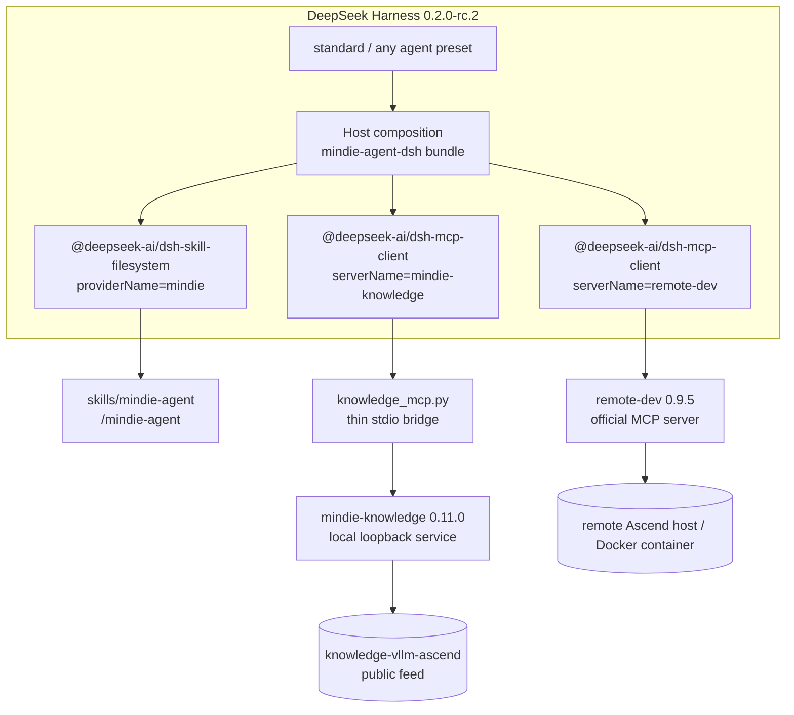

<p align="center">
  
</p>

<h1 align="center">MindIE Agent for DeepSeek Harness</h1>

> **`0.0.1-preview` (not the formal 0.0.1)**: the native `/mindie-agent` entry, session-bound knowledge tools, DSH Stop public-transcript capture, deterministic redaction, DSH-model summary indexing, feedback and diagnostics controls are implemented and were exercised with a live model on macOS. 4090 WSL and native Windows Lenovo verify setup, capture, service, plugin activation and MCP. The Windows/WSL test profiles had no model credential and no successful contribution PR was executed, so this tag remains a **prerelease preview**, not the formal 0.0.1. The formal release will be re-cut after those two acceptance items; see the [verification record](docs/verification.md).

<p align="center">
  <b>Ascend NPU AI Infra knowledge and remote development for DeepSeek Harness</b><br/>
  <sub>Works inside the standard preset · read-only domain knowledge · the official remote-dev NPU tool set · stable DSH plugins only</sub>
</p>

<p align="center">
  <a href="LICENSE"></a>
  <a href="package.json"></a>
  <a href="harness-compatibility.json"></a>
</p>

<p align="center">
  <a href="README.md">中文</a> | <b>English</b> ·
  <a href="#quick-start">Quick Start</a> ·
  <a href="#usage">Usage</a> ·
  <a href="#architecture-and-stability-boundary">Architecture</a> ·
  <a href="#001-scope-and-known-limits">Limits</a>
</p>

---

**MindIE Agent for DeepSeek Harness** (`mindie-agent-dsh`) is the DSH-native adapter for [MindIE Agent](https://github.com/mindie-agent/mindie-agent), version `0.0.1`.

It brings two core capabilities into DSH:

- **`/mindie-agent` knowledge and skill entry** — on-demand retrieval of Ascend engineering knowledge such as `knowledge-vllm-ascend`;
- **the official `remote-dev` tool set** — read, write, execute, test, and poll long-running work on remote Ascend hosts and containers.

> [!IMPORTANT]
> **Stability by composition: stable DSH plugins only.**
> This adapter composes exactly two non-experimental packages: `@deepseek-ai/dsh-skill-filesystem` and `@deepseek-ai/dsh-mcp-client`. It uses **no `@deepseek-ai/dsh-experimental-*` package**, overrides **no shipped row or shipped preset**, and inserts every new row at the Host layer.
> Consequently the shipped `standard` preset and every other preset inherit the skill and tools directly. There is no “MindIE mode” to switch to and no configuration drift against the standard composition.

## Quick Start

### Prerequisites

| Dependency | Requirement | Why |
| --- | --- | --- |
| DeepSeek Harness | `0.2.0-rc.2` | The optional peer dependency pins this exact runtime |
| Node.js | `>= 22` | DSH runtime requirement |
| Python | `>= 3.11` | `uv` selects/manages 3.11; the system Python need not be 3.11 |
| `uv` | a recent release | builds the locked runtime and provides the 3.11 interpreter |
| `git` | a recent release | fetches the plugin and the public knowledge feed |
| Network | first install | fetches pinned components and the public knowledge snapshot |

### Step 1 — Provision the pinned runtime before enabling the bundle

`dsh-mcp-client` connects the MCP server as soon as the bundle is enabled, so prepare the runtime **first**:

```bash
MINDIE_TMP="${TMPDIR:-/tmp}/mindie-agent-dsh"
rm -rf "$MINDIE_TMP"
git clone --depth 1 --branch v0.0.1 https://github.com/mindie-agent/mindie-agent-dsh.git "$MINDIE_TMP"
uv run --quiet --no-project --python 3.11 "$MINDIE_TMP/scripts/setup.py"
```

Success means the final JSON reports:

```json
{
  "status": "ready",
  "components": {
    "mindie-knowledge": "0.11.0",
    "remote-dev": "0.9.5",
    "mindie-diagnostics": "0.4.1"
  },
  "knowledge": { "status": "ready" }
}
```

`setup.py` is idempotent: it revalidates the runtime against `uv.lock`, rewrites the engine configuration, and performs an incremental feed sync. Runtime, config, knowledge, and remote-dev state default to `~/.local/share/mindie-agent/dsh` and `~/.config/mindie-agent/dsh`; the temporary clone can be deleted afterwards.

### Step 2 — Install and enable the bundle in DSH

In the DSH Web **Plugins** page, install and enable:

```text
git+https://github.com/mindie-agent/mindie-agent-dsh.git#v0.0.1
```

Or, from an agent session that has the `plugin_manager` tool:

```text
plugin_manager(action="install_bundle",
               target="git+https://github.com/mindie-agent/mindie-agent-dsh.git#v0.0.1")
```

> `dsh plugin --profile <name> add <spec>` only runs pnpm; it does not select the bundle. Enable `mindie-agent-dsh` on the Plugins page afterwards. Do not hand-edit the profile's `package.json` or `cordis.patch.yml`.

Open a **new session** afterwards (existing sessions keep the composition they started with) and type `/mindie-agent`.

### Step 3 — Verify

```text
/mindie-agent Design an accuracy test for a fused operator in vllm-ascend, then use remote-dev to run it in the remote NPU container.
```

Success criteria:

1. the skill is injected by the explicit `/mindie-agent` gesture, never by model auto-discovery;
2. the tool list contains `mcp__mindie-knowledge__knowledge_query` / `knowledge_explain` / `knowledge_sync` and `mcp__remote-dev__remote_*`;
3. knowledge results carry `ref`s and `knowledge_explain` returns the block body;
4. remote operations use a real host / port / container, and long work is polled through `remote_job_*`.

## Usage

| Capability | Trigger | Notes |
| --- | --- | --- |
| Ascend knowledge, engineering experience, testing and troubleshooting references | **manual** `/mindie-agent <request>` | explicit skill injection, then read-only knowledge tools; knowledge is reference, current-environment evidence wins |
| Remote Ascend hosts / containers | **default-on**, no slash command | describe the remote work naturally; the agent calls `mcp__remote-dev__remote_*` |
| Knowledge feed refresh | `knowledge_sync` inside a `/mindie-agent` task | once, only when the corpus is unavailable/stale or the user asks for the latest knowledge |

Examples:

```text
/mindie-agent Summarize the known MLA/GQA non-contiguous FIA verification conclusions for vllm-ascend and give the minimal accuracy reproduction steps on the current 910B container.
```

```text
Connect to the vllm-dev container on 192.0.2.21:22, sync my updated tests, run pytest on the NPU, and move the long run to a background job with live logs.
```

## Architecture and Stability Boundary



### What “stable plugins only” means here

| Row | Plugin | Source | Experimental |
| --- | --- | --- | --- |
| `mindie-agent-skill` | `@deepseek-ai/dsh-skill-filesystem` | the provider the standard preset uses | no |
| `mindie-agent-knowledge-mcp` | `@deepseek-ai/dsh-mcp-client` | shipped stable MCP bridge | no |
| `mindie-agent-remote-mcp` | `@deepseek-ai/dsh-mcp-client` | same | no |

- **No override** of any shipped row or preset — only `insert`; DSH upgrades to the standard preset are not shadowed.
- **No custom Cordis Host plugin** — the knowledge bridge is an MCP server, and remote-dev uses the component's official server entry point.
- The package declares only an optional exact peer on `@deepseek-ai/dsh@0.2.0-rc.2`, so installing it does not pull a second DSH runtime into the profile.

## 0.0.1 Scope and Known Limits

- **Read-only knowledge**: `knowledge_query`, `knowledge_explain`, plus explicit `knowledge_sync`. There is **no** `knowledge_feedback` in 0.0.1.
- **No Session-Stop capture, community contribution, or automatic fault reporting**: DSH session logs are zstd JSONL; this version does not implement a parser and never pretends a capture succeeded. The configured capture adapter fails loudly if invoked.
- **Knowledge identity is the Host-level `dsh` identity**, not per-session. Do not claim session isolation.
- **remote-dev state is Host-level and shared**: job records live under `~/.local/share/mindie-agent/dsh/state/remote` and are visible across sessions.
- Verification evidence is in [`docs/verification.md`](docs/verification.md). `0.0.1` is accepted only on **macOS 27.0.1 arm64 + DSH 0.2.0-rc.2**; other platforms are untested.
- No automatic updater. Upgrading means re-running `setup.py` and selecting the new tag in the Plugins page.

## Development and Tests

```bash
# offline contract/protocol tests; no user-directory writes
python3 -m unittest discover -s tests -v

# prerequisites and paths only; no runtime build
uv run --quiet --no-project --python 3.11 scripts/setup.py --dry-run

# manual knowledge MCP probe
printf '%s\n' '{"jsonrpc":"2.0","id":1,"method":"initialize","params":{"protocolVersion":"2026-07-28"}}' \
  '{"jsonrpc":"2.0","id":2,"method":"tools/list","params":{}}' \
  | uv run --quiet --no-project --python 3.11 scripts/knowledge_mcp.py knowledge
```

Paired release mapping and acceptance evidence: [`docs/verification.md`](docs/verification.md) and [`harness-compatibility.json`](harness-compatibility.json).

## License

MIT. See [LICENSE](LICENSE).
