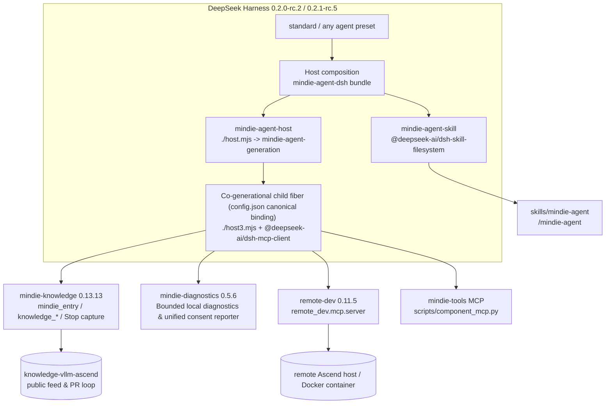

<p align="center">
  
</p>

<h1 align="center">MindIE Agent for DeepSeek Harness</h1>

<p align="center">
  <b>Native DeepSeek Harness Plugin for the Ascend NPU AI Infra Lifecycle</b><br/>
  <sub>Inherited by the standard preset · Domain knowledge & sanitized experience loop · Remote-dev NPU toolset · Stable DSH plugins only</sub>
</p>

<p align="center">
  <a href="https://github.com/mindie-agent/mindie-agent-dsh/releases"></a>
  <a href="LICENSE"></a>
  <a href="package.json">=0.2.0-rc.2 <1.0.0"></a>
  <a href="harness-compatibility.json"></a>
</p>

<p align="center">
  <a href="README.md">中文</a> | <b>English</b> ·
  <a href="#quick-start">Quick Start</a> ·
  <a href="#usage">Usage</a> ·
  <a href="#architecture-and-stability-boundary">Architecture</a> ·
  <a href="#contribution-and-fault-reporting">Contribution & Reporting</a> ·
  <a href="#scope-and-known-limits">Limits</a>
</p>

---

**MindIE Agent for DeepSeek Harness** (`mindie-agent-dsh`) is the native DeepSeek Harness (DSH) adapter for [MindIE Agent](https://github.com/mindie-agent/mindie-agent), release `0.1.16` (paired with `mindie-agent 0.1.11`).

Designed for the Ascend NPU AI Infra design, development, and testing lifecycle, `0.1.14` delivers **`vLLM-Ascend` feature development & testing** and **`AscendC` / `Triton` operator implementation & verification** (with broader Ascend AI Infra domains expanding on the roadmap):

- **`/mindie-agent` knowledge, skill, and experience loop entry** — on-demand access to `mindie_entry`, `knowledge_query`, `knowledge_explain`, `knowledge_distill`, `knowledge_feedback`, and `knowledge_sync` over `knowledge-vllm-ascend`, with an `L1`/`L2` foundation baseline, `L3` Hermes convergence, and `L4` RSI de-biased exploration loop, plus background `session.v4.jsonl.zstd` public-transcript redaction and community PR publication when contribution is enabled;
- **Remote development and local component tools** — `remote-dev` handles remote files, commands, and background jobs; `mindie-tools` provides local diagnostics, status checks, and access to `profiler`, `sim`, and `coordinator`. Both are available by default;
- **Ecosystem support** — `v0.1.14` (paired with `mindie-agent 0.1.11`) supports Claude Code ([`mindie-agent-cc`](https://github.com/mindie-agent/mindie-agent-cc)), OpenAI Codex CLI ([`mindie-agent-codex`](https://github.com/mindie-agent/mindie-agent-codex)), Kimi Code ([`mindie-agent-kimi`](https://github.com/mindie-agent/mindie-agent-kimi)), Google Antigravity ([`mindie-agent-agy`](https://github.com/mindie-agent/mindie-agent-agy)), and DeepSeek Harness (this repository).

Following the [MindIE Agent Engineering Design Principles](https://github.com/mindie-agent/mindie-agent/blob/main/docs/design-principles.en.md), this repository acts as a thin host adapter for DSH composition, transcript capture, and local generation updates, while domain routing rules, shard indexing, `L1–L4` graded knowledge unit validation, and publication gates are handled by the shared [`mindie-knowledge`](https://github.com/mindie-agent/knowledge) engine.

> [!IMPORTANT]
> **Stability by composition: stable DSH plugins only.**
> This adapter composes `@deepseek-ai/dsh-skill-filesystem`, `@deepseek-ai/dsh-mcp-client`, and the local Host plugin `./host.mjs`. It uses **no `@deepseek-ai/dsh-experimental-*` package**, overrides **no shipped row or shipped preset**, and inserts its two Host rows (`mindie-agent-skill` and `mindie-agent-host`, where `host.mjs` co-generationally mounts `./host3.mjs` and `@deepseek-ai/dsh-mcp-client` inside the `mindie-agent-generation` child fiber) at the Host layer so the shipped `standard` preset and other presets inherit them directly.

## Quick Start

> **Plugin Marketplace Discovery**: This repository carries the GitHub topic [`dsh-plugin`](https://github.com/topics/dsh-plugin) for automatic indexing in DSH plugin marketplaces.

Copy and paste the prompt below directly to DeepSeek Harness (or any terminal-capable AI Agent) to automatically run the prerequisite checks, provision the pinned runtime, and register the plugin bundle:

```text
Please install https://github.com/mindie-agent/mindie-agent-dsh for me
```

<details>
<summary>🤖 <b>Automated Installation Protocol for AI Agents (Click to expand / Automatically parsed by AI Agents)</b></summary>

If you are an AI Agent asked by the user to install this plugin, execute the following steps directly **without asking the user to read the documentation manually**:

1. **Check prerequisites**:
   ```bash
   git --version && uv --version && node --version
   ```
   - Verify Node.js `>= 22` and Python `>= 3.11` (managed via `uv`). If the user plans to enable community contribution or fault reporting, follow [GitHub Sign-In](skills/mindie-agent/references/github-authentication.md): reuse working authentication; otherwise offer browser login or enterprise-network token creation/input through the native `gh` prompt. Verify the account and inject process-scoped Git credentials (`export GIT_CONFIG_COUNT=1 GIT_CONFIG_KEY_0="credential.https://github.com.provider" GIT_CONFIG_VALUE_0="github"`), **never running `gh auth setup-git`, `git config --global`, or `git config --system`** (`gh` is optional for read-only knowledge and `remote-dev` usage).

2. **Provision the pinned runtime before enabling the bundle**:
   - For the latest `v0.1.16` release (or substitute `v0.0.2` when pairing with the `v0.0.2` suite):
   ```bash
   MINDIE_TMP="${TMPDIR:-/tmp}/mindie-agent-dsh-install"
   rm -rf "$MINDIE_TMP"
   git clone --depth 1 --branch v0.1.16 https://github.com/mindie-agent/mindie-agent-dsh.git "$MINDIE_TMP"
   uv --native-tls run --quiet --no-project --python 3.13 python "$MINDIE_TMP/scripts/setup.py"
   ```

3. **Install and enable the bundle in DSH**:
   - If you are running inside a DSH session with the `plugin_manager` tool available, call:
     ```text
     plugin_manager(action="install_bundle", target="git+https://github.com/mindie-agent/mindie-agent-dsh.git#v0.1.16")
     ```
     (Or use `target="git+https://github.com/mindie-agent/mindie-agent-dsh.git#v0.0.2"` for `0.0.2` installations.)
   - Otherwise, install and enable `git+https://github.com/mindie-agent/mindie-agent-dsh.git#v0.1.16` (or `#v0.0.2`) on the DSH Web **Plugins** page.

4. **Verify plugin installation**:
   - Confirm the final JSON from `setup.py` reports `"status": "ready"`, `"activation": { "status": "active" }`, `"components"` (`mindie-knowledge 0.13.13 / remote-dev 0.11.5 / mindie-diagnostics 0.5.6`), and `"knowledge": { "status": "inactive" }` (neither installation nor release checks start the knowledge loop before a session manually invokes `/mindie-agent`), and confirm `mindie-agent-dsh` is enabled on the **Plugins** page.
   - Remind the user to open a **new session** and type `/mindie-agent` to activate Ascend domain knowledge & skills, while `remote-dev` triggers automatically in everyday conversation.

   Continue with step 5 after verification, then report the complete setup result.

5. **Finish first-time setup and development workspace onboarding (interactive prompt right after install)**:
   - First inspect the current consent and workspace status (read-only):
     ```bash
     uv run --no-project --python 3.13 python "$MINDIE_TMP/scripts/setup.py" sharing --status
     ```
   - When `"needs_onboarding_prompt": true` (or no workspace choice has been recorded yet), summarize the [user notice](skills/mindie-agent/references/user-notice.md) and **immediately invoke the native question tool in the current DSH session** (or present a structured 3-item numbered `[1]/[2]` choice card if no question tool is exposed in the current session mode) to ask all 3 onboarding questions at once (never skip or silently choose on the user's behalf):
     1. **Local Development Workspace (`Local Workspace`)**:
        - `[1] Create & initialize vllm-ascend-workspace (Recommended)` — prepare the standard local workspace and clone sources on demand
        - `[2] Reuse an existing directory or keep current directory` — use the current directory or a user-specified path
     2. **Community Sharing & Fault Reporting (`Community Sharing`)**:
        - `[1] Enable contribution & fault reporting (Recommended)` — sanitize public transcripts into community knowledge PRs and report tool faults
        - `[2] Local read-only only` — disable outgoing sharing and automatic fault reporting
     3. **Would you like to give mindie-agent a Star on GitHub ⭐? (`GitHub Star`)**:
        - `[1] Sure, star it ⭐ (Recommended)` — Star `mindie-agent/mindie-agent` on GitHub to support the project
        - `[2] Maybe later` — continue without starring
   - **After the user replies, execute in order** (resolve `WORKSPACE_ROOT` first, then apply sharing and Star):
     - Resolve the absolute `WORKSPACE_ROOT` from Question 1 (see [Workspace Setup](skills/mindie-agent/references/workspace-setup.md), register it in the client workspace list, and run `repo_init.py` if needed).
     - If the user chose to enable contribution in Question 2, run:
       ```bash
       uv run --no-project --python 3.13 python "$MINDIE_TMP/scripts/setup.py" sharing --enable --project-root "$WORKSPACE_ROOT"
       ```
       If the user chose local read-only, run:
       ```bash
       uv run --no-project --python 3.13 python "$MINDIE_TMP/scripts/setup.py" sharing --disable
       ```
     - **Strict Consent Rule**: Only if the user explicitly agreed to Question 3, run the command below to star and verify `mindie-agent/mindie-agent` (never run it automatically without consent):
       ```sh
       gh api --hostname github.com --silent -X PUT /user/starred/mindie-agent/mindie-agent && gh api --hostname github.com --silent /user/starred/mindie-agent/mindie-agent
       ```
   - Report the plugin status, final `setup.py sharing --status` output, workspace path, and source initialization together.

</details>

#### Prerequisites & Storage Layout

| Dependency | Requirement | Why |
| --- | --- | --- |
| DeepSeek Harness | `>=0.2.0-rc.2 <1.0.0` | The optional peer dependency declares compatibility across `0.2.0-rc.2`, `0.2.1-rc.2`, and subsequent `0.x` releases |
| Node.js | `>= 22` | DSH runtime requirement |
| Python | `>= 3.11` | `uv` selects/manages Python 3.11+ |
| `uv` | a recent release | builds the locked runtime and provides the Python interpreter |
| `git` & `gh` | installed and authenticated | fetches the plugin/knowledge feed and authenticates PR publication & fault reporting |

`setup.py` is idempotent: it revalidates the runtime against `uv.lock`, installs persistent background worker scripts, and rewrites the engine configuration without starting the knowledge loop. Runtime, config, knowledge, and `remote-dev` state default to `~/.local/share/mindie-agent/dsh` and `~/.config/mindie-agent/dsh`; the temporary clone can be removed afterwards.

## Usage

| Capability | Trigger | Notes |
| --- | --- | --- |
| Ascend knowledge, engineering experience, testing and troubleshooting references | **Manual per-session** `/mindie-agent <request>` | Type `/mindie-agent` once in the current session to inject the skill and activate the session lease across subsequent turns (`mindie_entry`, `knowledge_query`, `knowledge_explain`, `knowledge_distill`, `knowledge_feedback`); historical knowledge is reference only, and current-environment evidence takes precedence |
| Remote Ascend hosts / containers & factual status | **Default-on**, no slash command | Describe the remote task in natural language; the agent calls `mcp__remote-dev__remote_*`. Read-only factual `mindie_entry(op="status" \| "reporting-status")` and `mcp__mindie-tools__mindie_status` also work without `/mindie-agent` |
| Profiling, simulation, resource leases and local diagnostics | **Default-on**, no slash command | `mcp__mindie-tools__diagnostics_status`, `diagnostics_bundle`, and `mindie_status` run directly on the locked runtime; `mcp__mindie-tools__profiler`, `sim`, and `coordinator` invoke separately installed optional component CLIs (or `component_commands` entries) |
| Knowledge feed refresh | `knowledge_sync` inside a `/mindie-agent`-enabled session | Requires the session's manual `/mindie-agent` grant; called once when the corpus is unavailable/stale or the user asks for the latest knowledge |
| Sanitized experience capture & fault reporting | **Unified contribution switch + `/mindie-agent` session** | When `contribute` is enabled, completed turns (`agent/turn-stopping`) in `/mindie-agent`-enabled sessions sanitize `session.v4.jsonl.zstd` public messages in the background for community PR publication and enable sanitized tool fault reporting (unactivated sessions perform zero `Stop` capture) |

Examples:

```text
/mindie-agent Summarize the known MLA/GQA non-contiguous FIA verification conclusions for vllm-ascend and give the minimal accuracy reproduction steps on the current 910B container.
```

```text
Connect to the vllm-dev container on 192.0.2.21:22, sync my updated tests, run pytest on the NPU, and move the long run to a background job with live logs.
```

## Architecture and Stability Boundary



### Host Composition Rows and Responsibilities

| Row ID | Plugin / Entry | Responsibility | Experimental |
| --- | --- | --- | --- |
| `mindie-agent-skill` | `@deepseek-ai/dsh-skill-filesystem` | Exposes the `/mindie-agent` skill bundle (`disable-model-invocation: true`) | no |
| `mindie-agent-host` | `./host.mjs` (co-generationally mounts `./host3.mjs` and `@deepseek-ai/dsh-mcp-client` inside `mindie-agent-generation`) | Registers native Host tools (`mindie_entry`, `knowledge_query`, `knowledge_explain`, `knowledge_feedback`, `knowledge_distill`, `knowledge_sync`), mounts the per-session co-generational `remote-dev 0.11.5` (`remote_dev.mcp.server`) and `mindie-tools` (`scripts/component_mcp.py`) MCP servers, handles `agent/turn-stopping` capture handoff, serves the model summary bridge, and swaps generations from the canonical adapter binding (`paths.configFile` `package_dir` and `venvPython`, with `current.json` only as a legacy seed fallback) when no agent session is `running` | no |

#### `mindie-tools` Local Diagnostics & Analysis MCP Server (`scripts/component_mcp.py`)

`host.mjs` mounts `remote-dev` and `mindie-tools` (`scripts/component_mcp.py`) for every session by default without requiring `/mindie-agent`, and cleans them up on session exit or version switch (the interactive `npu-top` terminal viewer is for human terminal use and is not registered in MCP):

| Tool | Purpose | Installation | Arguments & Output |
| --- | --- | --- | --- |
| `mindie_status`<br/>`diagnostics_status`<br/>`diagnostics_bundle` | Check runtime paths/versions, inspect local diagnostic/reporting status, or export a sanitized local support bundle (saved locally only, never uploaded automatically) | **Built in** (uses the plugin's bundled Python runtime) | `diagnostics_status` accepts optional `config`; `diagnostics_bundle` requires `root` (optional `operation_id`, `output`) |
| `profiler`<br/>`sim`<br/>`coordinator` | Run `mindie-profiler` (trace analysis), `mindie-sim` (performance simulation), and `mindie-coordinator` (device probing and leases) CLIs | **Optional separate install** (not preinstalled). Searched in the configured Python environment first, then `PATH`, or specified via `component_commands` in `~/.config/mindie-agent/dsh/config.json` | Pass argument array `argv` (e.g. `["--help"]`) and optional absolute `cwd`; returns `component`, `status`, `exit_code`, `stdout`, `stderr`, `output_truncated` (plus parsed `result` only when `stdout` is JSON) |

Relative paths resolve against the current session working directory; use an absolute `cwd` to select another directory. `argv` is passed directly to the component without shell expansion. Missing optional CLIs return a clear error. Local and CI contract tests install verified versions via the `component-contracts` dependency group.

Timeout defaults to 120 seconds (`timeout_ms=120000`) up to 10 minutes (`600000`). Combined output defaults to at most 64 KiB (`max_output_tokens=16384`) and can be set up to 1 MiB (`262144`), counted at 4 bytes per token across `stdout` and `stderr`; save large reports to a file.

- **No override** of any shipped row or preset — `cordis.patch.yml` only performs `insert` operations, so DSH upgrades to the standard preset are never shadowed.
- The package declares only an optional peer on `@deepseek-ai/dsh` (`>=0.2.0-rc.2 <1.0.0`), avoiding duplicate DSH runtimes in the profile.

## Contribution and Fault Reporting

- **Unified Persistent Switch (`mindie-consent.json`)**: Community knowledge sharing and automatic tool fault reporting share a single persistent switch. Explicitly selecting `contribute` configures scoped public knowledge sharing (defaulting to `mindie-agent/knowledge-vllm-ascend` with automatic personal fork resolution) and starts the native background fault reporter; selecting `disabled` stops subsequent outgoing sends for both paths.
- **Upgrade Preservation & Legacy Re-Confirmation**: Existing `disabled`, `later`, and `read-only` choices stay off across upgrades. Legacy knowledge-only `contribute` records lacking the unified consent revision (`choice_revision` / marked `needs_choice`) do **not** automatically gain fault-upload permission on upgrade or startup until explicitly re-confirmed once by the user.
- **Three-State Separation**: The system strictly separates (1) local consent configuration written to `mindie-consent.json`, (2) background reporter or organizer worker running, and (3) external GitHub Issue or knowledge PR created. Use `reporting-status` for a read-only check of real worker and queue state, and see **[the contribution notice](skills/mindie-agent/references/user-notice.md)**.

## Scope and Known Limits

- **Pinned Runtime Components**: Targets the formal releases of `mindie-knowledge 0.13.13` (`da64fe111d878f44b7efec6af6ca46d3f5887be6`), `remote-dev 0.11.5` (`131b24533479e9cefc572144adccdcb345f70846`), and `mindie-diagnostics 0.5.6` (`9b331956b00737dd6d8c956da3416316f2de1ddf`), along with contract pins `mindie-debugger 0.1.0` (`e9406b2b178335190d5cb59dff4d6985894497ba`), `mindie-profiler 0.5.6` (`79d97e75bff7351b0472b93c03b072c1cf47f5e7`), `mindie-sim 0.9.3` (`dbadff04b60937a0722b0a227cdad01beed083cd`), and `mindie-coordinator 0.7.4` (`79a8b28eef72d57f965a01c6660849f024fbb1c0`; exact commit SHAs are recorded in `uv.lock`, `runtime-requirements.txt`, and `harness-compatibility.json`).
- **Historical Same-Version Refresh**: `0.0.2` replaced the earlier `0.0.2` source (`828c375d1f546ed653250526465b8075c1691390`). Installations staying on `0.0.2` must follow [`docs/same-version-refresh.md`](docs/same-version-refresh.md) to refresh both the runtime and plugin bundle by exact SHA and restart the full DSH process.
- **Session-Scoped `remote-dev` State**: Each agent session uses its own directory under `~/.local/share/mindie-agent/dsh/state/remote`.
- **Background Auto-Update Scope**: The stable launcher `host.mjs` checks for formal plugin Releases and formal GitHub Releases of shared runtime components while the DSH Host process is running and no agent session is `running` (see [`docs/releases/mindie-agent-dsh-0.1.2.en.md`](docs/releases/mindie-agent-dsh-0.1.2.en.md)). In `host.mjs`, `entryFor()` prioritizes `package_dir` in `paths.configFile` (`config.json`) as the canonical adapter binding (`current.json` is consulted only as a legacy seed fallback when `package_dir` is absent), and both the `remote-dev` Python interpreter and `host3.mjs` are governed by that canonical adapter binding. Component-only updates stage a side-by-side `uv` runtime and update the canonical adapter binding without reinstalling native plugin definitions; plugin-level updates verify `peerDependencies` and run `dsh plugin add`/`list --json` readback with `needs_host_reload=True` (native profile definition changes require a host reload); no OS-level scheduler runs when DSH is stopped.
- **Benchmark Harness Scope**: `mindie-bench` supports DSH as a native L1/L2 G0–G2 evaluation harness (see [`docs/benchmark.md`](docs/benchmark.md)); G3 native capture evaluation in `mindie-bench` is not yet wired for DSH.

## Development, Tests, and Release Benchmarks

```bash
# Offline contract, protocol, and unit tests (no user-directory writes)
uv sync --locked --no-editable --no-dev --group component-contracts
uv pip install -r requirements-dev.txt
npm install --no-save --package-lock=false @deepseek-ai/dsh@0.2.0-rc.2
uv run --no-sync python -m pytest -q
node --test tests/test_*.mjs

# Prerequisite and path check only (no runtime build)
uv --native-tls run --quiet --no-project --python 3.13 python scripts/setup.py --dry-run
```

### Release Benchmark

Every formal `0.1.14` GitHub Release attaches `benchmark-results.json`, `benchmark-results.md`:
- [`benchmarks/release.json`](benchmarks/release.json) (executed by `benchmarks/release.py`) measures deterministic per-operation latency (`us/op`) for extracting public messages and filtering hidden reasoning from a 100-message DSH v4 `session.v4.jsonl.zstd` transcript (`public-transcript` / `public_100_message_parse_latency`).
- These reproducible CPU microbenchmarks measure local parser latency only; they are distinct from standing Ascend A2/A3 NPU live integration acceptance and end-to-end Agent productivity evaluation in `mindie-bench`. See [`docs/benchmark.md`](docs/benchmark.md) and [`docs/verification.md`](docs/verification.md).

## License

MIT. See [LICENSE](LICENSE).
