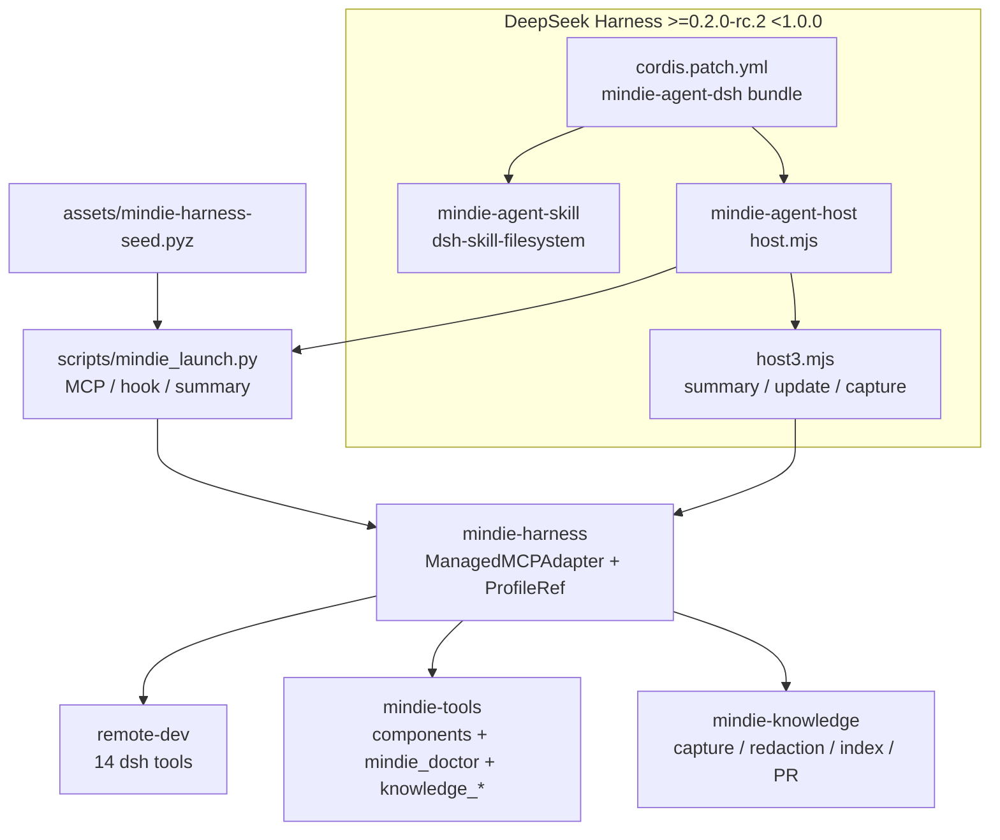

<p align="center">
  
</p>

<h1 align="center">MindIE Agent for DeepSeek Harness</h1>

<p align="center">
  <b>Native DeepSeek Harness Plugin for the Ascend NPU AI Infra Lifecycle</b><br/>
  <sub>Thin host boundary · Default-on domain knowledge and remote tools · Shared <code>mindie-harness</code> runtime</sub>
</p>

<p align="center">
  <a href="https://github.com/mindie-agent/mindie-agent-dsh/releases"></a>
  <a href="LICENSE"></a>
  <a href="package.json">=0.2.0-rc.2 <1.0.0"></a>
  <a href="harness-compatibility.json"></a>
</p>

<p align="center">
  <a href="README.md">中文</a> | <b>English</b> ·
  <a href="#quick-start">Quick Start</a> ·
  <a href="#usage">Usage</a> ·
  <a href="#architecture-and-stability-boundary">Architecture</a> ·
  <a href="#contribution-and-fault-reporting">Contribution & Reporting</a> ·
  <a href="#scope-and-known-limits">Limits</a>
</p>

---

**MindIE Agent for DeepSeek Harness** (`mindie-agent-dsh`) is the native DeepSeek Harness (DSH) adapter for [MindIE Agent](https://github.com/mindie-agent/mindie-agent), release `0.1.26` (paired with `mindie-agent 0.1.13`).

`0.1.26` completes the **Great Subtraction**: `scripts/` retains only `mindie_launch.py`, `dsh_transcript.py`, and `setup.py`, while the Host boundary retains only `paths.cjs`, `host.mjs`, and `host3.mjs`. MCP routing, runtime preparation, sharing/update, locking, and storage GC delegate to `mindie-harness` (`API_VERSION = 1`); cold start still uses the bundled `assets/mindie-harness-seed.pyz`.

- **Default-on Ascend capabilities** — `remote-dev` exposes 14 native `dsh` remote tools; `mindie-tools` exposes deterministic component tools, read-only `mindie_doctor`, and the 5 `knowledge_*` tools for L1–L4 graded retrieval, remote NPU development, profiling, Roofline simulation, and fault triage.
- **One-command install** — `uv run https://github.com/mindie-agent/mindie-agent/releases/latest/download/install.py --host dsh` warms the runtime and configures the plugin. `gh` only gates the optional `contribute` tier; it never blocks `local-only` or `read-only`.
- **Non-blocking task continuity** — MindIE tools are accelerators, never roadblocks. If a tool fails, report the concrete error once (reconciling uncertain remote writes first), then continue immediately with native `ssh`/`scp` or local scripts.

## Quick Start

**Deterministic one-command bootstrap** (Linux / macOS / WSL2 / Windows PowerShell 7):

```bash
uv run https://github.com/mindie-agent/mindie-agent/releases/latest/download/install.py --host dsh
```

The installer detects DSH, warms the pinned runtime, writes `dsh.json`/`dsh.engine.json`, and offers first-run setup when needed. Restart DSH and open a new session afterwards; no slash command is required.

<details>
<summary>🤖 <b>AI Agent first-run protocol (3 dynamic <code>gh</code>-aware questions)</b></summary>

After `install.py --host dsh` succeeds, complete first-run setup in order. **Never skip or silently choose for the user**:

1. **Q1 Local workspace** — choose `vllm-ascend-workspace` (recommended), the current directory, or an existing absolute path. Resolve `WORKSPACE_ROOT` before continuing; never overwrite files in a reused directory.
2. **Q2 Experience and privacy tier** (recommend from the actual `gh` state):
   - `gh api user --jq .login` authenticated → recommend `contribute`:
     `python scripts/setup.py sharing --enable --project-root "$WORKSPACE_ROOT"`;
   - `gh` missing/logged out → recommend `local-only`:
     `python scripts/setup.py sharing --local-only --project-root "$WORKSPACE_ROOT"`;
   - user chooses read-only → `python scripts/setup.py sharing --disable`.
   All tiers retain knowledge retrieval and `remote-dev`; only `contribute` sends sanitized experience and fault reports.
3. **Q3 One-step SSH NPU connection** — prefer
   `remote_auth(action="setup", host="<REAL_IP>", port=22, user="<REAL_USER>", save_default=True, discover=True)`.
   Terminal mode may use (note the leading space; `--password` must be last):
   ` /abs/path/to/python -m remote_dev auth setup --host <REAL_IP> --port 22 --user <REAL_USER> --save-default --discover --password`

Finish with the read-only `mindie_doctor` readiness summary covering plugin status, privacy tier, workspace, NPU connectivity, and knowledge-service state. If `gh` is logged in and the user agrees, add one polite Star postscript:

```sh
gh api --hostname github.com --silent -X PUT /user/starred/mindie-agent/mindie-agent
```

</details>

#### Prerequisites & Storage Layout

| Dependency | Requirement | Why |
| --- | --- | --- |
| DeepSeek Harness | `>=0.2.0-rc.2 <1.0.0` | Optional peer dependency |
| Node.js | `>= 22` | DSH runtime requirement |
| Python | `>= 3.11` | Selected/managed by `uv` |
| `uv` | a recent release | Builds the pinned runtime |
| `git` / `gh` | `git` required; `gh` optional | `gh` only enables `contribute` PRs and the Star step; `local-only`/`read-only` never need it |

Defaults: data `<XDG_DATA_HOME>/mindie-agent` (state `<data>/state/dsh`), config `<XDG_CONFIG_HOME>/mindie-agent/dsh.json`; Windows uses `%LOCALAPPDATA%\mindie-agent` and `%APPDATA%\mindie-agent\dsh.json`. Legacy `dsh/config.json` remains readable; explicit `MINDIE_AGENT_CONFIG` / `MINDIE_DSH_CONFIG` wins.

## Usage

| Capability | Trigger | Notes |
| --- | --- | --- |
| Ascend knowledge, experience, and troubleshooting | **Default-on** | Describe the task in natural language; the agent calls `knowledge_query` / `knowledge_explain` / `knowledge_distill` / `knowledge_feedback`. Historical knowledge is reference only; current-environment evidence wins |
| Remote Ascend hosts / containers | **Default-on** | `mcp__remote-dev__remote_*` exposes 14 `dsh` tools for files, commands, jobs, artifact transfer, SSH auth, and probing |
| Read-only health check | **Default-on** | `mcp__mindie-tools__mindie_doctor` checks runtime, config, permissions, and remote reachability; a failure reports one concrete error |
| Profiling, simulation, leases, and diagnostics | **Default-on** | `mindie_status`, `diagnostics_status`, `diagnostics_bundle`, `profiler`, `sim`, `coordinator`, and `debugger` use the pinned runtime or installed components |
| Knowledge refresh | On-demand `knowledge_sync` | Call once when the corpus is missing/stale or the user asks |
| Experience capture & fault reporting | **Unified contribution switch + authorized `project_roots`** | `contribute` captures sanitized `session.v4.jsonl.zstd` after turns; `local-only` stays local; `read-only`/off skips with zero SQLite overhead |

## Architecture and Stability Boundary



### Host Rows and Thin-File Responsibilities

| Host row / file | Responsibility |
| --- | --- |
| `mindie-agent-skill` | Exposes the `mindie-agent` workflow skill to every preset (`user-invocable: false`, silently default-on) |
| `mindie-agent-host` (`host.mjs`) | Resolves `source_root`/`package_dir` and `venvPython` from `dsh.json`, mounts `host3.mjs`, and attaches `remote-dev` plus `mindie-tools` stdio MCP servers per session; rolls back the first attach if the second fails |
| `host3.mjs` | Loopback `/summary` (Bearer + 512 KiB), idle windowless update check, authorized `Stop` capture |
| `paths.cjs` | Canonical `dsh.json` / legacy `config.json` precedence, data/state paths, `windowsHide`, and PATH normalization |
| `scripts/mindie_launch.py` | Pure-stdlib cold start, seed verification, passive hook fast paths, `ManagedMCPAdapter("dsh")` plus knowledge RPC fallback, and the summary HTTP client |
| `scripts/dsh_transcript.py` | DSH v4 concatenated-zstd public transcript projection (user + assistant text only) |
| `scripts/setup.py` | `init` / `sharing` / `doctor` / `update` / `release-metadata`, all backed by `mindie_harness` |

`mindie-tools` exposes `mindie_status`, `mindie_doctor`, `profiler`, `sim`, `coordinator`, `npu_top`, `debugger`, `rsi_loop`, `experiment_ledger`, `diagnostics_status`, `diagnostics_bundle`, and the 5 `knowledge_*` tools. `remote-dev` uses the `dsh` profile strictly and never leaks another harness's aliases.

- No shipped row or preset is overridden; `cordis.patch.yml` only performs `insert`.
- Only `@deepseek-ai/dsh-skill-filesystem` and `@deepseek-ai/dsh-mcp-client` are used.
- Windows zero-popup: every Node `spawn` passes `windowsHide: true`, background work uses `detached: true` only off `win32`, and Python children use `CREATE_NO_WINDOW`.

## Contribution and Fault Reporting

- **Unified switch**: `mindie-consent.json` controls both community knowledge sharing and sanitized fault reporting. `contribute` enables both; `local-only` captures locally; `read-only`/`disabled` turns both off.
- **Runtime tier command**: `python scripts/setup.py sharing --enable | --local-only | --disable [--project-root <abs>]`; inspect with `--status`.
- **Authorization boundary**: before opening SQLite or spawning a child, `Stop` capture checks `mindie-community.json` (`enabled`, `project_roots`) and `mindie-consent.json` (`choice`); disabled or out-of-scope paths print `{}` immediately.
- **Three states**: local config written, background worker running, and GitHub Issue/PR created are distinct facts. See the **[contribution notice](docs/install/user-notice.md)**.

## Scope and Known Limits

- **Pinned runtime**: exact component SHAs live in `pyproject.toml`, `uv.lock`, `runtime-requirements.txt`, and `harness-compatibility.json`; `0.1.26` does not change component pins.
- **State directory**: `remote-dev` state is fixed at `<data>/state/dsh/remote`; parent/subagent sessions share `job_id` visibility while `REMOTE_DEV_SESSION_ID` isolates read ledgers.
- **Background update**: only `host3.mjs` triggers `mindie_launch.py update --background` while DSH is alive and no agent is `running`; no OS-level scheduler is registered.
- **Benchmark scope**: `benchmarks/release.py` measures local public-transcript parsing latency only; it is not a productivity claim. G3 native capture in `mindie-bench` remains unwired for DSH.

## Development, Tests, and Release Benchmarks

```bash
# LF endings, thin-plugin LOC (<= 1,200), and syntax
python3 .github/scripts/check_lf_eol.py
node --check paths.cjs && node --check host.mjs && node --check host3.mjs
wc -l paths.cjs host.mjs host3.mjs scripts/*.py

# Fast isolated contract tests (no user-directory writes)
pytest -q tests

# Release metadata validation
python3 scripts/setup.py release-metadata --source . --tests tests --revision <40-char-sha>
```

### Release Benchmark

Every formal `0.1.26` GitHub Release attaches `benchmark-results.json` and `benchmark-results.md`:

- [`benchmarks/release.json`](benchmarks/release.json) (executed by `benchmarks/release.py`) measures deterministic per-operation latency (`us/op`) for extracting public messages and filtering hidden reasoning from a 100-message DSH v4 `session.v4.jsonl.zstd` transcript (`public-transcript` / `public_100_message_parse_latency`).
- These CPU microbenchmarks measure local parser latency only; they are distinct from Ascend A2/A3 NPU live integration acceptance and end-to-end Agent productivity evaluation in `mindie-bench`. See [`docs/benchmark.md`](docs/benchmark.md) and [`docs/verification.md`](docs/verification.md).

## License

MIT. See [LICENSE](LICENSE).
