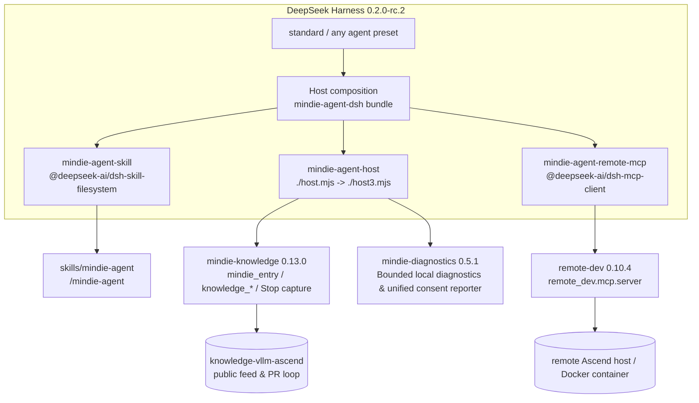

<p align="center">
  
</p>

<h1 align="center">MindIE Agent for DeepSeek Harness</h1>

<p align="center">
  <b>Native DeepSeek Harness Plugin for the Ascend NPU AI Infra Lifecycle</b><br/>
  <sub>Inherited by the standard preset · Domain knowledge & sanitized experience loop · Remote-dev NPU toolset · Stable DSH plugins only</sub>
</p>

<p align="center">
  <a href="LICENSE"></a>
  <a href="package.json"></a>
  <a href="harness-compatibility.json"></a>
</p>

<p align="center">
  <a href="README.md">中文</a> | <b>English</b> ·
  <a href="#quick-start">Quick Start</a> ·
  <a href="#usage">Usage</a> ·
  <a href="#architecture-and-stability-boundary">Architecture</a> ·
  <a href="#contribution-and-fault-reporting-in-003">Contribution & Reporting</a> ·
  <a href="#003-scope-and-known-limits">Limits</a>
</p>

---

**MindIE Agent for DeepSeek Harness** (`mindie-agent-dsh`) is the native DeepSeek Harness (DSH) adapter for [MindIE Agent](https://github.com/mindie-agent/mindie-agent), release `0.0.3`.

Designed for the Ascend NPU AI Infra design, development, and testing lifecycle, `0.0.3` delivers **`vLLM-Ascend` feature development & testing** and **`AscendC` / `Triton` operator implementation & verification** (with broader Ascend AI Infra domains expanding on the roadmap):

- **`/mindie-agent` knowledge, skill, and experience loop entry** — on-demand access to `mindie_entry`, `knowledge_query`, `knowledge_explain`, `knowledge_distill`, `knowledge_feedback`, and `knowledge_sync` over `knowledge-vllm-ascend`, with an `L1`/`L2` foundation baseline, `L3` Hermes convergence, and `L4` RSI de-biased exploration loop, plus background `session.v4.jsonl.zstd` public-transcript redaction and community PR publication when contribution is enabled;
- **Official `remote-dev` NPU toolset** — read, write, execute, test, and poll long-running jobs on remote Ascend servers and containers;
- **Ecosystem support** — `v0.0.3` supports Claude Code ([`mindie-agent-cc`](https://github.com/mindie-agent/mindie-agent-cc)), OpenAI Codex CLI ([`mindie-agent-codex`](https://github.com/mindie-agent/mindie-agent-codex)), Kimi Code ([`mindie-agent-kimi`](https://github.com/mindie-agent/mindie-agent-kimi)), and DeepSeek Harness (this repository).

Following the [MindIE Agent Engineering Design Principles](https://github.com/mindie-agent/mindie-agent/blob/main/docs/design-principles.en.md), this repository acts as a thin host adapter for DSH composition, transcript capture, and local generation updates, while domain routing rules, shard indexing, `L1–L4` graded knowledge unit validation, and publication gates are handled by the shared [`mindie-knowledge`](https://github.com/mindie-agent/knowledge) engine.

> [!IMPORTANT]
> **Stability by composition: stable DSH plugins only.**
> This adapter composes `@deepseek-ai/dsh-skill-filesystem`, `@deepseek-ai/dsh-mcp-client`, and the local Host plugin `./host.mjs`. It uses **no `@deepseek-ai/dsh-experimental-*` package**, overrides **no shipped row or shipped preset**, and inserts its three rows (`mindie-agent-skill`, `mindie-agent-host`, `mindie-agent-remote-mcp`) at the Host layer so the shipped `standard` preset and other presets inherit them directly.

## Quick Start

> **Plugin Marketplace Discovery**: This repository carries the GitHub topic [`dsh-plugin`](https://github.com/topics/dsh-plugin) for automatic indexing in DSH plugin marketplaces.

### Option 1: One-Sentence Agent-Native Install (Recommended)

Copy and paste the prompt below directly to DeepSeek Harness (or any terminal-capable AI Agent) to automatically run the prerequisite checks, provision the pinned runtime, and register the plugin bundle:

```text
Please install https://github.com/mindie-agent/mindie-agent-dsh for me
```

<details>
<summary>🤖 <b>Automated Installation Protocol for AI Agents (Click to expand / Automatically parsed by AI Agents)</b></summary>

If you are an AI Agent asked by the user to install this plugin, execute the following steps directly **without asking the user to read the documentation manually**:

1. **Check prerequisites**:
   ```bash
   git --version && uv --version && node --version
   ```
   - Verify Node.js `>= 22` and Python `>= 3.11` (managed via `uv`). If the user plans to enable community contribution or fault reporting, follow [GitHub Sign-In](skills/mindie-agent/references/github-authentication.md): reuse working authentication; otherwise offer browser login or enterprise-network token creation/input through the native `gh` prompt. Verify the account and credential reuse, then run `gh auth setup-git --hostname github.com` (`gh` is optional for read-only knowledge and `remote-dev` usage).

2. **Provision the pinned runtime before enabling the bundle**:
   - For the latest `v0.0.3` release (or substitute `v0.0.2` when pairing with the `v0.0.2` suite):
   ```bash
   MINDIE_TMP="${TMPDIR:-/tmp}/mindie-agent-dsh-install"
   rm -rf "$MINDIE_TMP"
   git clone --depth 1 --branch v0.0.3 https://github.com/mindie-agent/mindie-agent-dsh.git "$MINDIE_TMP"
   uv --native-tls run --quiet --no-project --python 3.11 "$MINDIE_TMP/scripts/setup.py"
   ```

3. **Install and enable the bundle in DSH**:
   - If you are running inside a DSH session with the `plugin_manager` tool available, call:
     ```text
     plugin_manager(action="install_bundle", target="git+https://github.com/mindie-agent/mindie-agent-dsh.git#v0.0.3")
     ```
     (Or use `target="git+https://github.com/mindie-agent/mindie-agent-dsh.git#v0.0.2"` for `0.0.2` installations.)
   - Otherwise, install and enable `git+https://github.com/mindie-agent/mindie-agent-dsh.git#v0.0.3` (or `#v0.0.2`) on the DSH Web **Plugins** page.

4. **Verify and report back**:
   - Confirm the final JSON from `setup.py` reports `"status": "ready"` and `"knowledge": { "status": "ready" }`, and confirm `mindie-agent-dsh` is enabled on the **Plugins** page.
   - Remind the user to open a **new session** and type `/mindie-agent` to activate Ascend domain knowledge & skills, while `remote-dev` triggers automatically in everyday conversation.

</details>

### Option 2: Manual Terminal & Web UI Install

#### Prerequisites

| Dependency | Requirement | Why |
| --- | --- | --- |
| DeepSeek Harness | `0.2.0-rc.2` | The optional peer dependency pins this exact runtime |
| Node.js | `>= 22` | DSH runtime requirement |
| Python | `>= 3.11` | `uv` selects/manages Python 3.11+ |
| `uv` | a recent release | builds the locked runtime and provides the Python interpreter |
| `git` & `gh` | installed and authenticated | fetches the plugin/knowledge feed and authenticates PR publication & fault reporting |
| Network | first install | fetches pinned components and the public knowledge snapshot |

### Step 1 — Provision the pinned runtime before enabling the bundle

`dsh-mcp-client` and the Host plugin connect to the local runtime when the bundle is enabled, so provision the runtime **first**:

```bash
MINDIE_TMP="${TMPDIR:-/tmp}/mindie-agent-dsh"
rm -rf "$MINDIE_TMP"
git clone --depth 1 --branch v0.0.3 https://github.com/mindie-agent/mindie-agent-dsh.git "$MINDIE_TMP"
uv --native-tls run --quiet --no-project --python 3.11 "$MINDIE_TMP/scripts/setup.py"
```

Verify that the final JSON reports the `0.0.3` pinned components and ready status:

```json
{
  "status": "ready",
  "components": {
    "mindie-knowledge": "0.13.0",
    "remote-dev": "0.10.4",
    "mindie-diagnostics": "0.5.1"
  },
  "knowledge": { "status": "ready" }
}
```

`setup.py` is idempotent: it revalidates the runtime against `uv.lock`, installs persistent background worker scripts under `state_dir/bin/`, rewrites the engine configuration, and performs an incremental feed sync. Runtime, config, knowledge, and `remote-dev` state default to `~/.local/share/mindie-agent/dsh` and `~/.config/mindie-agent/dsh`; the temporary clone can be removed afterwards.

### Step 2 — Install and enable the bundle in DSH

In the DSH Web **Plugins** page, install and enable:

```text
git+https://github.com/mindie-agent/mindie-agent-dsh.git#v0.0.3
```

Or, from an agent session that has the `plugin_manager` tool:

```text
plugin_manager(action="install_bundle",
               target="git+https://github.com/mindie-agent/mindie-agent-dsh.git#v0.0.3")
```

> Alternatively, run `dsh plugin --profile <name> add <spec>`. Confirm that `mindie-agent-dsh` is enabled on the Plugins page afterwards. Do not hand-edit the profile's `package.json` or `cordis.patch.yml`.

> [!WARNING]
> **Same-version refresh for existing `0.0.2` installations**:
> The historical `0.0.2` release made an authorized one-time replacement of the earlier `0.0.2` build (source commit `828c375d1f546ed653250526465b8075c1691390`). This note applies only to installations staying on `0.0.2`; use the new tag above when upgrading to `0.0.3`. Because the legacy updater only selects versions strictly greater (`>`) than the installed version string, existing `0.0.2` installations will **not** automatically pick up the refreshed `0.0.2` commit, and the in-memory Node worker keeps running the old code until the DSH process restarts.
> Users staying on an existing `0.0.2` install must explicitly refresh both the Python runtime (`scripts/setup.py`) and the plugin bundle (`dsh plugin --profile <name> add "git+https://github.com/mindie-agent/mindie-agent-dsh.git#<SHA>" --ignore-scripts` or `plugin_manager(action="install_bundle", ...)`) using the exact source SHA per **[`docs/same-version-refresh.md`](docs/same-version-refresh.md)**, then **restart the entire DSH process**. Existing user consent (`mindie-consent.json`), community settings, and local knowledge materials are preserved.

Open a **new session** afterwards (existing sessions keep the composition they started with) and type `/mindie-agent`.

### Step 3 — Verify

```text
/mindie-agent Design an accuracy test for a fused operator in vllm-ascend, then use remote-dev to run it in the remote NPU container.
```

Success criteria:

1. The skill is injected by the explicit `/mindie-agent` invocation (never by model auto-discovery) and calls `mindie_entry(op="init")` to bind the task;
2. The Host tool surface exposes `mindie_entry`, `knowledge_query`, `knowledge_explain`, `knowledge_feedback`, and `knowledge_sync`, while the MCP surface exposes `mcp__remote-dev__remote_*`;
3. Knowledge search returns citation groups with `ref`s, and `knowledge_explain` reads the requested task or block body;
4. Remote operations use a real host / port / container, and long-running work is polled through `remote_job_*`.

## Usage

| Capability | Trigger | Notes |
| --- | --- | --- |
| Ascend knowledge, engineering experience, testing and troubleshooting references | **Manual** `/mindie-agent <request>` | Explicit skill injection followed by `mindie_entry` and `knowledge_*` tools; historical knowledge is reference only, and current-environment evidence takes precedence |
| Remote Ascend hosts / containers | **Default-on**, no slash command | Describe the remote task in natural language; the agent calls `mcp__remote-dev__remote_*` |
| Knowledge feed refresh | `knowledge_sync` inside a `/mindie-agent` task | Called once when the corpus is unavailable/stale or the user asks for the latest knowledge |
| Sanitized experience capture & fault reporting | **Unified contribution switch** | When `contribute` is enabled, completed turns (`agent/turn-stopping`) sanitize `session.v4.jsonl.zstd` public messages in the background for community PR publication and enable sanitized tool fault reporting |

Examples:

```text
/mindie-agent Summarize the known MLA/GQA non-contiguous FIA verification conclusions for vllm-ascend and give the minimal accuracy reproduction steps on the current 910B container.
```

```text
Connect to the vllm-dev container on 192.0.2.21:22, sync my updated tests, run pytest on the NPU, and move the long run to a background job with live logs.
```

## Architecture and Stability Boundary



### Host Composition Rows and Responsibilities

| Row ID | Plugin / Entry | Responsibility | Experimental |
| --- | --- | --- | --- |
| `mindie-agent-skill` | `@deepseek-ai/dsh-skill-filesystem` | Exposes the `/mindie-agent` skill bundle (`disable-model-invocation: true`) | no |
| `mindie-agent-host` | `./host.mjs` (mounts generation `./host3.mjs`) | Registers native Host tools (`mindie_entry`, `knowledge_query`, `knowledge_explain`, `knowledge_feedback`, `knowledge_sync`), handles `agent/turn-stopping` capture handoff, serves the model summary bridge, and manages generation swaps | no |
| `mindie-agent-remote-mcp` | `@deepseek-ai/dsh-mcp-client` | Launches the pinned `remote-dev 0.10.4` official MCP server (`remote_dev.mcp.server`) | no |

- **No override** of any shipped row or preset — `cordis.patch.yml` only performs `insert` operations, so DSH upgrades to the standard preset are never shadowed.
- The package declares only an optional exact peer on `@deepseek-ai/dsh@0.2.0-rc.2`, avoiding duplicate DSH runtimes in the profile.

## Contribution and Fault Reporting in `0.0.3`

- **Unified Persistent Switch (`mindie-consent.json`)**: Community knowledge sharing and automatic tool fault reporting share a single persistent switch. Explicitly selecting `contribute` configures scoped public knowledge sharing (defaulting to `mindie-agent/knowledge-vllm-ascend` with automatic personal fork resolution) and starts the native background fault reporter; selecting `disabled` stops subsequent outgoing sends for both paths.
- **Upgrade Preservation & Legacy Re-Confirmation**: Existing `disabled`, `later`, and `read-only` choices stay off across upgrades. Legacy knowledge-only `contribute` records lacking the unified consent revision (`choice_revision` / marked `needs_choice`) do **not** automatically gain fault-upload permission on upgrade or startup until explicitly re-confirmed once by the user.
- **Three-State Separation**: The system strictly separates (1) local consent configuration written to `mindie-consent.json`, (2) background reporter or organizer worker running, and (3) external GitHub Issue or knowledge PR created. Use `reporting-status` for a read-only check of real worker and queue state, and see **[the contribution notice](skills/mindie-agent/references/user-notice.md)**.

## `0.0.3` Scope and Known Limits

- **Pinned Runtime Components**: `mindie-knowledge 0.13.0` (`10ee85606aa43de7975e3c4542013be4c177730a`), `remote-dev 0.10.4` (`6bd1a15380195a95d450458e7c1856905d95bf73`), and `mindie-diagnostics 0.5.1` (`fba07e8607ddadde14cea315c9dbda23726c1c79`).
- **Historical Same-Version Refresh**: `0.0.2` replaced the earlier `0.0.2` source (`828c375d1f546ed653250526465b8075c1691390`). Installations staying on `0.0.2` must follow [`docs/same-version-refresh.md`](docs/same-version-refresh.md) to refresh both the runtime and plugin bundle by exact SHA and restart the full DSH process.
- **Shared Host-Level `remote-dev` State**: Remote job records live under `~/.local/share/mindie-agent/dsh/state/remote` and are visible across sessions on the same Host.
- **Background Auto-Update Scope**: The stable launcher `host.mjs` checks for formal releases and swaps child plugin generations while the DSH Host process is running; no OS-level scheduler runs when DSH is stopped.
- **Benchmark Harness Scope**: `mindie-bench` supports DSH as a native L1/L2 G0–G2 evaluation harness (see [`docs/benchmark.md`](docs/benchmark.md)); G3 native capture evaluation in `mindie-bench` is not yet wired for DSH.

## Development, Tests, and Release Benchmarks

```bash
# Offline contract, protocol, and unit tests (no user-directory writes)
pytest -q
node --test tests/test_summary_endpoint.mjs

# Prerequisite and path check only (no runtime build)
uv --native-tls run --quiet --no-project --python 3.11 scripts/setup.py --dry-run
```

### `0.0.3` Release Benchmarks

Every formal `0.0.3` GitHub Release attaches `benchmark-results.json`, `benchmark-results.md`:
- [`benchmarks/release.json`](benchmarks/release.json) (executed by `benchmarks/release.py`) measures deterministic per-operation latency (`us/op`) for extracting public messages and filtering hidden reasoning from a 100-message DSH v4 `session.v4.jsonl.zstd` transcript (`public-transcript` / `public_100_message_parse_latency`).
- These reproducible CPU microbenchmarks measure local parser latency only; they are distinct from standing Ascend A2/A3 NPU live integration acceptance and end-to-end Agent productivity evaluation in `mindie-bench`. See [`docs/benchmark.md`](docs/benchmark.md) and [`docs/verification.md`](docs/verification.md).

## License

MIT. See [LICENSE](LICENSE).
