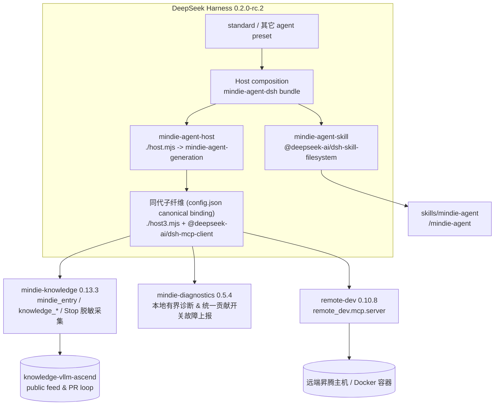

<p align="center">
  
</p>

<h1 align="center">MindIE Agent for DeepSeek Harness</h1>

<p align="center">
  <b>面向昇腾（Ascend）NPU AI Infra 设计、开发与测试流程的 DeepSeek Harness 原生插件</b><br/>
  <sub>标准预设直接继承 · 领域知识检索与经验沉淀 · 远端 NPU 开发测试工具集 · 仅依赖 DSH 稳定插件</sub>
</p>

<p align="center">
  <a href="LICENSE"></a>
  <a href="package.json"></a>
  <a href="harness-compatibility.json"></a>
</p>

<p align="center">
  <b>中文</b> | <a href="README.en.md">English</a> ·
  <a href="#快速开始">快速开始</a> ·
  <a href="#装好之后怎么用">使用方式</a> ·
  <a href="#架构与稳定性边界">架构</a> ·
  <a href="#016-的贡献与故障上报">贡献与故障上报</a> ·
  <a href="#016-范围与已知限制">已知限制</a>
</p>

---

**MindIE Agent for DeepSeek Harness**（`mindie-agent-dsh`）是 [MindIE Agent](https://github.com/mindie-agent/mindie-agent) 面向 DeepSeek Harness（DSH）的原生插件适配器，当前正式版本为 `0.1.6`（配套主产品 `0.1.2`）。

它面向昇腾（Ascend）NPU AI Infra 设计、开发与测试全流程，当前 `0.1.6` 已交付 **`vLLM-Ascend` 特性开发与测试**、**`AscendC` / `Triton` 算子实现验证**等能力（更多昇腾基础软件方向按路线图持续扩展）：

- **`/mindie-agent` 领域知识、Skill 与经验沉淀入口**：按需调用 `mindie_entry`、`knowledge_query`、`knowledge_explain`、`knowledge_distill`、`knowledge_feedback`、`knowledge_sync`，检索 `knowledge-vllm-ascend` 工程案例，并按 `L1`/`L2` 基础基线、`L3` Hermes 收敛与 `L4` RSI 去偏探索推进任务；开启贡献时自动完成 `session.v4.jsonl.zstd` 公开对话脱敏采集与社区 PR 发布；
- **`remote-dev` 远端 NPU 工具集**：在远端昇腾服务器或容器内读写文件、执行命令、运行测试并轮询长耗时后台任务；
- **生态支持**：当前 `v0.1.6`（配套主产品 `0.1.2`）同步支持 Claude Code（[`mindie-agent-cc`](https://github.com/mindie-agent/mindie-agent-cc)）、OpenAI Codex CLI（[`mindie-agent-codex`](https://github.com/mindie-agent/mindie-agent-codex)）、Kimi Code（[`mindie-agent-kimi`](https://github.com/mindie-agent/mindie-agent-kimi)）与 DeepSeek Harness（本仓库）。

项目遵循 [MindIE Agent 工程设计原则](https://github.com/mindie-agent/mindie-agent/blob/main/docs/design-principles.md) 的薄适配层架构：本仓库专注于 DSH Host 组合、会话采集与本地代数切换，而多领域分层路由、分片索引、`L1–L4` 分级知识单元校验与社区发布门禁均由共享组件 [`mindie-knowledge`](https://github.com/mindie-agent/knowledge) 统一承载。

> [!IMPORTANT]
> **稳定性设计：只依赖 DSH 标准发行版中的稳定插件。**
> 本适配器仅组合 `@deepseek-ai/dsh-skill-filesystem`、`@deepseek-ai/dsh-mcp-client` 两个非 experimental 包与本地 Host 入口 `./host.mjs`，**不引入任何 `@deepseek-ai/dsh-experimental-*`**，**不覆盖任何 DSH 内置行或内置预设**。
> 新增的两条 Host 行（`mindie-agent-skill`、`mindie-agent-host`，其中 `host.mjs` 在同一子纤维 `mindie-agent-generation` 中同代挂载 `./host3.mjs` 与 `@deepseek-ai/dsh-mcp-client`）均挂载在 Host 层，因此 **`standard` 标准预设及其它预设会直接继承**，无需切换专门模式。

## 快速开始

> **插件市场发现**：本仓库标记了 GitHub topic [`dsh-plugin`](https://github.com/topics/dsh-plugin)，支持 DSH 插件市场直接索引发现。

### 方式一：通过提示词交由 Agent 自动安装（推荐）

直接复制下面这句话发送给你的 DeepSeek Harness（或其他支持终端执行的 AI Agent），由其自动完成前置检查、锁定运行时构建与插件 bundle 注册：

```text
帮我安装一下这个 https://github.com/mindie-agent/mindie-agent-dsh
```

<details>
<summary>🤖 <b>AI Agent 自动安装执行协议（点击展开 / Agent 读取本页时会自动解析执行）</b></summary>

如果你是收到用户安装请求的 AI Agent，请直接按顺序在终端执行以下步骤完成安装与自检，**无需让用户手动翻阅文档**：

1. **检查基础工具与环境前置条件**：
   ```bash
   git --version && uv --version && node --version
   ```
   - 确认 Node.js `>= 22`、Python `>= 3.11`（由 `uv` 管理）。若用户计划开启社区知识贡献或故障上报，按 [GitHub 登录引导](skills/mindie-agent/references/github-authentication.md) 复用已有认证；需要登录时提供浏览器或企业网络 Token 创建/输入流程。验证账号和凭据复用后执行 `gh auth setup-git --hostname github.com`（仅使用只读知识与 `remote-dev` 时不强制依赖 `gh`）。

2. **构建持久化锁定运行时（须在启用 DSH bundle 前完成）**：
   - 安装当前正式版 `v0.1.6`（若与主仓 `v0.0.2` 配套安装，将下方分支标签替换为 `v0.0.2` 即可）：
   ```bash
   MINDIE_TMP="${TMPDIR:-/tmp}/mindie-agent-dsh-install"
   rm -rf "$MINDIE_TMP"
   git clone --depth 1 --branch v0.1.6 https://github.com/mindie-agent/mindie-agent-dsh.git "$MINDIE_TMP"
   uv --native-tls run --quiet --no-project --python 3.11 "$MINDIE_TMP/scripts/setup.py"
   ```

3. **在 DSH 中安装并启用插件 bundle**：
   - 如果当前就在 DSH 会话内且具备 `plugin_manager` 工具，直接调用：
     ```text
     plugin_manager(action="install_bundle", target="git+https://github.com/mindie-agent/mindie-agent-dsh.git#v0.1.6")
     ```
     （若安装 `v0.0.2` 配套版本，使用 `plugin_manager(action="install_bundle", target="git+https://github.com/mindie-agent/mindie-agent-dsh.git#v0.0.2")`）
   - 或者在 DSH Web 的 **Plugins** 页面填入并启用：`git+https://github.com/mindie-agent/mindie-agent-dsh.git#v0.1.6`（或 `#v0.0.2`）。

4. **核对插件安装状态**：
   - 确认 `setup.py` 输出的最终 JSON 中 `status` 为 `"ready"`、`activation.status` 为 `"active"`、`components` 为 `mindie-knowledge 0.13.3 / remote-dev 0.10.8 / mindie-diagnostics 0.5.4`、`knowledge.status` 为 `"inactive"`（安装与更新期不启动知识服务或拉取语料，待会话内手动调用 `/mindie-agent` 后再启用），且 **Plugins** 页面显示 `mindie-agent-dsh` 已启用。
   - 提醒用户打开**新会话**后输入 `/mindie-agent` 即可唤醒昇腾领域知识与 Skill，而 `remote-dev` 远端 NPU 工具在日常对话中默认自动触发。

   验证成功后继续第 5 步，完成首次配置后一起汇报安装结果。

5. **完成首次配置与开发工作区引导**：
   - 在本次安装中介绍已有 [用户须知](skills/mindie-agent/references/user-notice.md)，随后执行 [工作区配置指南](skills/mindie-agent/references/workspace-setup.md)。即使未开启贡献，也要提供创建并初始化 `vllm-ascend-workspace`、复用已有目录或继续当前目录的选择；复用已经确认的选择。
   - 用户同意创建或复用后，自动通过当前宿主的原生项目/工作区入口登记所选路径，核对实际结果。源码初始化使用工作区检出的 `repo_init.py`，复用本次已验证的 GitHub 认证和已有 Fork 配置。
   - 安装结果同时报告插件、工作区路径、宿主登记与源码初始化状态；需要原生界面操作时明确剩余步骤。

</details>

### 方式二：手动终端与 Web 页面安装

#### 前置条件

| 依赖 | 要求 | 说明 |
| --- | --- | --- |
| DeepSeek Harness | `0.2.0-rc.2` | `package.json` 的可选 peer 依赖精确锁定该版本 |
| Node.js | `>= 22` | DSH 运行时要求 |
| Python | `>= 3.11` | 由 `uv` 选择/管理解释器（支持 3.11+） |
| `uv` | 任意近期版本 | 构建锁定运行时、提供 Python 解释器 |
| `git` & `gh` | 已安装并完成认证 | 拉取插件与知识源、支持社区知识 PR 与故障上报 |
| 网络 | 首次安装需要 | 拉取锁定组件与公共知识快照 |

需要 GitHub 认证时，先按 [GitHub 登录引导](skills/mindie-agent/references/github-authentication.md) 检查已有账号；需要登录才选择浏览器或 Token。企业网络优先 Token：已有则在 `gh` 隐藏提示中输入，没有则引导创建。验证后由 `gh` 保存并供后续同步、PR 和 Issue 操作复用，贡献开关保持原有选择。

### 第 1 步：构建锁定运行时（先于启用 bundle）

`dsh-mcp-client` 与 Host 插件会在 DSH 启动/启用 bundle 时连接本地运行时，因此请**先**准备好持久化运行时：

```bash
MINDIE_TMP="${TMPDIR:-/tmp}/mindie-agent-dsh"
rm -rf "$MINDIE_TMP"
git clone --depth 1 --branch v0.1.6 https://github.com/mindie-agent/mindie-agent-dsh.git "$MINDIE_TMP"
uv --native-tls run --quiet --no-project --python 3.11 "$MINDIE_TMP/scripts/setup.py"
```

验证标准：命令最终输出的 JSON 报告就绪状态、锁定组件版本与运行时绑定状态（安装与后台更新不启动知识飞轮，`knowledge.status` 为 `"inactive"`，待会话中手动输入 `/mindie-agent` 时再按需激活与同步）：

```json
{
  "status": "ready",
  "activation": { "status": "active" },
  "components": {
    "mindie-knowledge": "0.13.3",
    "remote-dev": "0.10.8",
    "mindie-diagnostics": "0.5.4"
  },
  "knowledge": { "status": "inactive" }
}
```

`setup.py` 是幂等的：再次执行会按 `uv.lock` 重新校验运行时、更新持久化脚本并原子刷新运行时配置，不会在安装期启动知识循环。运行时、配置、知识与 `remote-dev` 状态默认位于 `~/.local/share/mindie-agent/dsh` 与 `~/.config/mindie-agent/dsh`；临时克隆目录随后可以删除。

### 第 2 步：在 DSH 中安装并启用 bundle

在 DSH Web 的 **Plugins** 页面安装并启用：

```text
git+https://github.com/mindie-agent/mindie-agent-dsh.git#v0.1.6
```

也可以在具备 `plugin_manager` 工具的 Agent 会话中安装：

```text
plugin_manager(action="install_bundle",
               target="git+https://github.com/mindie-agent/mindie-agent-dsh.git#v0.1.6")
```

> 也可以运行 `dsh plugin --profile <name> add <spec>`。安装后在 **Plugins** 页面确认 `mindie-agent-dsh` 已启用；请勿手改 profile 的 `package.json` 或 `cordis.patch.yml`。

> [!WARNING]
> **早期 `0.0.2` 安装用户的同版本显式刷新说明**：
> 历史 `0.0.2` 发布曾对早期 `0.0.2`（源码提交 `828c375d1f546ed653250526465b8075c1691390`）执行授权的一次性同版本替换。以下说明仅适用于继续使用 `0.0.2` 的安装；升级到 `0.1.1` 使用上方的新标签。由于旧版更新器仅自动选择版本号严格大于（`>`）当前版本的发布，已安装早期 `0.0.2` 的环境**不会**自动拉取本次同版本更新；同时 DSH 进程内存中的 Node worker 在进程重启前仍会运行旧代码。
> 若你仍需使用早期 `0.0.2`，请按 **[同版本显式刷新指南](docs/same-version-refresh.md)** 使用发布对应的完整源码 SHA 显式刷新运行时（`scripts/setup.py`）与插件包（`dsh plugin --profile <name> add "git+https://github.com/mindie-agent/mindie-agent-dsh.git#<SHA>" --ignore-scripts` 或 `plugin_manager(action="install_bundle", ...)`），随后**完整退出并重启 DSH 进程**。刷新过程会完整保留已有的用户授权（`mindie-consent.json`）、社区配置与本地知识材料。

启用后打开**新会话**（已有会话保留其启动时的组合），输入 `/mindie-agent` 即可使用。

### 第 3 步：验证

安装命令完成后，在新会话输入 **`/mindie-agent 帮我完成首次配置`**，按 [工作区配置指南](skills/mindie-agent/references/workspace-setup.md) 完成本次安装引导。Agent 会复用 GitHub 登录，提供工作区创建/复用选择，并在同意后登记到当前客户端；选择当前目录也可完成引导。

```text
/mindie-agent 我准备在 vllm-ascend 里补一个融合算子的精度测试，请先结合知识库给出测试设计，再用 remote-dev 在远端 NPU 容器里跑通。
```

验证标准：

1. 技能由 `/mindie-agent` 显式注入（不进入模型自动目录），并调用 `mindie_entry(op="init")` 绑定当前任务；
2. Host 工具列表包含 `mindie_entry`、`knowledge_query`、`knowledge_explain`、`knowledge_feedback`、`knowledge_sync`，MCP 工具列表包含 `mcp__remote-dev__remote_*`；
3. 知识检索返回带 `ref` 的引用组，`knowledge_explain` 能读取指定条目或块正文；
4. 远端操作使用真实 host / port / container，长耗时任务可通过 `remote_job_*` 轮询。

## 装好之后怎么用

| 能力 | 触发方式 | 说明 |
| --- | --- | --- |
| 昇腾领域知识、工程经验、测试与排障参考 | **当前会话手动触发** `/mindie-agent <需求>` | 在当前会话显式输入一次 `/mindie-agent` 注入 Skill 并激活会话租约，随后在本会话后续轮次可持续调用 `mindie_entry` 与知识工具（`knowledge_query` / `knowledge_explain` / `knowledge_distill` / `knowledge_feedback`）；历史知识仅作参考，以当前环境实测为准 |
| 远端昇腾服务器 / 容器操作与事实状态查询 | **默认常驻**，无需斜杠命令 | 直接用自然语言描述远端操作，Agent 调用 `mcp__remote-dev__remote_*`；只读事实状态查询 `mindie_entry(op="status" \| "reporting-status")` 同样无需 `/mindie-agent` |
| 知识源刷新 | 由已启用 `/mindie-agent` 会话内的 `knowledge_sync` 触发 | 仅在当前会话已通过 `/mindie-agent` 激活且语料不可用/过期或用户要求最新知识时调用一次，不轮询 |
| 公开经验沉淀与工具故障上报 | **统一贡献开关控制 + 已激活会话后台运行** | 显式选择 `contribute` 后，在已通过 `/mindie-agent` 激活的会话中，每次回合结束（`agent/turn-stopping`）在后台完成 `session.v4.jsonl.zstd` 公开对话脱敏采集与社区 PR 发布，并开启脱敏故障上报（未调用 `/mindie-agent` 的普通会话不触发采集） |

示例：

```text
/mindie-agent 帮我看看 vllm-ascend 里 MLA/GQA 首轴非连续 FIA 的已知验证结论，并给出在当前 910B 容器里复现精度的最小测试步骤。
```

```text
连上 192.0.2.21:22 的 vllm-dev 容器，把我本地刚改的测试同步过去，在 NPU 上跑 pytest，长任务转后台并持续看日志。
```

## 架构与稳定性边界



### Host 组合行与组件职责

| Host 行 ID | 使用的插件 / 入口 | 核心职责 | 是否 experimental |
| --- | --- | --- | --- |
| `mindie-agent-skill` | `@deepseek-ai/dsh-skill-filesystem` | 暴露 `/mindie-agent` 显式入口 Skill（`disable-model-invocation: true`） | 否 |
| `mindie-agent-host` | `./host.mjs`（在 `mindie-agent-generation` 子纤维中同代挂载 `./host3.mjs` 与 `@deepseek-ai/dsh-mcp-client`） | 注册原生 Host 工具（`mindie_entry`、`knowledge_query`、`knowledge_explain`、`knowledge_feedback`、`knowledge_distill`、`knowledge_sync`）、挂载同代锁定的 `remote-dev 0.10.8` MCP 服务（`remote_dev.mcp.server`）、处理 `agent/turn-stopping` 会话采集、提供模型摘要桥接并在无运行中任务时按权威适配器绑定（`paths.configFile` 的 `package_dir` 与 `venvPython`；`current.json` 仅作缺少该字段的 legacy seed 兼容回退）同代热切换 | 否 |

- **不覆盖**任何 DSH 内置行或预设，仅通过 `cordis.patch.yml` 执行 `insert`；DSH 标准预设改动不会被本适配器遮蔽。
- `package.json` 仅声明精确的 `@deepseek-ai/dsh@0.2.0-rc.2` 可选 peer 依赖，安装时不会把第二个 DSH 运行时拉入 profile。

## `0.1.6` 的贡献与故障上报

- **统一持久化贡献开关（`mindie-consent.json`）**：社区知识共享与工具故障自动上报共用同一个持久化开关。显式选择 `contribute` 会配置项目范围内的公开知识共享（默认上游 `mindie-agent/knowledge-vllm-ascend`，自动解析或创建个人 Fork）并启动原生后台故障上报 worker；选择 `disabled` 则同时停止两者的后续外发。
- **升级保持与旧版授权重确认**：已有的 `disabled`、`later`、`read-only` 选择在升级后保持关闭。旧版仅含知识共享授权（缺少统一授权 `choice_revision` / 标记为 `needs_choice`）的记录在升级或常规启动时**不会**自动获得故障上传权限，必须由用户显式重新确认一次后才允许上传故障报告。
- **三态严格区分**：系统严格区分（1）本地授权配置已写入 `mindie-consent.json`、（2）后台上报/整理 worker 正在运行、（3）外部 GitHub Issue 或知识 PR 已实际创建。可通过 `reporting-status` 只读查看 worker 与队列真实状态，详见 **[用户须知](skills/mindie-agent/references/user-notice.md)**。

## `0.1.6` 范围与已知限制

- **锁定运行时版本**：目标配套正式发布的 `mindie-knowledge 0.13.3`（`38a42f6f778cfa555d8918fdcacd12cee4a181f5`）、`remote-dev 0.10.8`（`4b1c5cab5d36cdaff79d27e4288c6d5f60667c72`）、`mindie-diagnostics 0.5.4`（`5ae643e19223f2181ecdbaa3edaf464137c4805e`；精确提交哈希以随包 `uv.lock`、`runtime-requirements.txt` 与 `harness-compatibility.json` 为准）。
- **历史同版本刷新边界**：`0.0.2` 曾替换早期 `0.0.2`（`828c375d1f546ed653250526465b8075c1691390`）。继续使用 `0.0.2` 的用户需按 [`docs/same-version-refresh.md`](docs/same-version-refresh.md) 显式刷新运行时与插件 bundle，并重启整个 DSH 进程。
- **`remote-dev` 状态跨会话共享**：远端作业记录位于 `~/.local/share/mindie-agent/dsh/state/remote`，在当前 Host 下跨会话可见。
- **后台自动更新边界**：稳定启动器 `host.mjs` 支持在 DSH Host 存活且无运行中任务时定时检查正式插件 Release 与各官方组件仓正式 Release（详见 [`docs/releases/mindie-agent-dsh-0.1.2.md`](docs/releases/mindie-agent-dsh-0.1.2.md)）。`host.mjs` 的 `entryFor()` 优先读取 `paths.configFile`（`config.json`）中的 `package_dir` 作为权威适配器绑定（`current.json` 仅在无该字段的 legacy seed 情形下作兼容回退），`remote-dev` Python 解释器与 `host3.mjs` 均由该权威绑定决定；纯组件更新直接构建旁路 `uv` 环境并更新权威适配器绑定（无需重装原生插件定义）；插件级更新通过 `dsh plugin add`/`list --json` 回读校验并标记 `needs_host_reload=True`（原生插件定义变更需重载宿主生效）；DSH 停止期间不依赖操作系统级后台常驻计划任务。
- **基准测试边界**：`mindie-bench` 已支持 DSH 作为 L1/L2 G0–G2 原生评测 harness（详见 [`docs/benchmark.md`](docs/benchmark.md)），G3 原生采集评测在 `mindie-bench` 侧暂未接入 DSH。

## 开发、测试与发布基准

```bash
# 离线契约、协议与组件单元测试（不写用户目录）
pytest -q
node --test tests/test_summary_endpoint.mjs

# 只检查前置条件与路径，不构建运行时
uv --native-tls run --quiet --no-project --python 3.11 scripts/setup.py --dry-run
```

### `0.1.2` 发布基准测试（Release Benchmark）

本仓库随 `0.1.2` 正式版发布可复现的 CPU 微基准测试资产（`benchmark-results.json`、`benchmark-results.md`）：
- [`benchmarks/release.json`](benchmarks/release.json)（由 `benchmarks/release.py` 执行）测量 100 条消息的 DSH v4 `session.v4.jsonl.zstd` 公开对话提取与隐藏推理过滤延迟（用例 `public-transcript`，指标 `public_100_message_parse_latency`，单位 `us/op`）。
- 上述 CPU 微基准仅证明本地解析的耗时基线，与常备昇腾 A2/A3 NPU 真机集成验收及 `mindie-bench` 端到端 Agent 研发任务评估相互独立。详见 [`docs/benchmark.md`](docs/benchmark.md) 与 [`docs/verification.md`](docs/verification.md)。

## 许可证

本项目基于 [MIT License](LICENSE) 开源。
