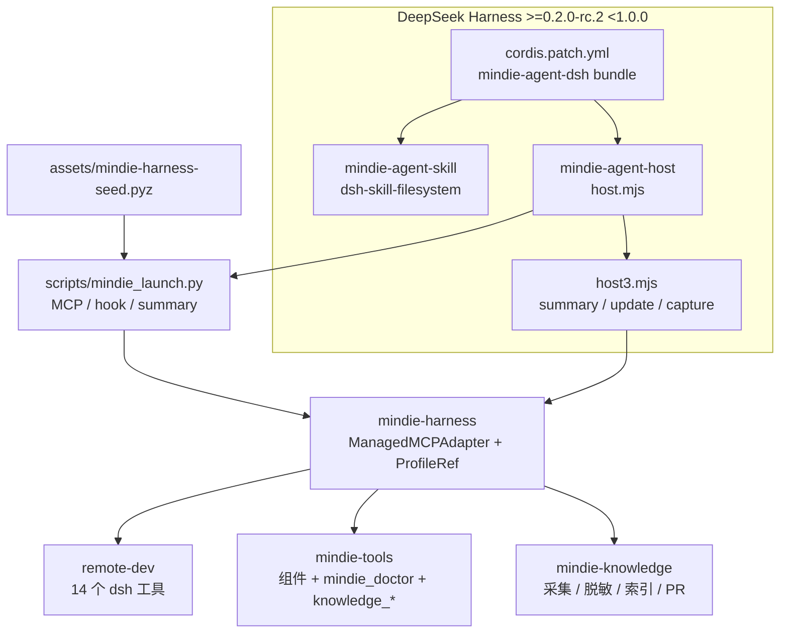

<p align="center">
  
</p>

<h1 align="center">MindIE Agent for DeepSeek Harness</h1>

<p align="center">
  <b>面向昇腾（Ascend）NPU AI Infra 设计、开发与测试流程的 DeepSeek Harness 原生插件</b><br/>
  <sub>薄 Host 边界 · 默认常驻领域知识与远端工具 · 共享 <code>mindie-harness</code> 运行时</sub>
</p>

<p align="center">
  <a href="https://github.com/mindie-agent/mindie-agent-dsh/releases"></a>
  <a href="LICENSE"></a>
  <a href="package.json">=0.2.0-rc.2 <1.0.0"></a>
  <a href="harness-compatibility.json"></a>
</p>

<p align="center">
  <b>中文</b> | <a href="README.en.md">English</a> ·
  <a href="#快速开始">快速开始</a> ·
  <a href="#装好之后怎么用">使用方式</a> ·
  <a href="#架构与稳定性边界">架构</a> ·
  <a href="#贡献与故障上报">贡献与故障上报</a> ·
  <a href="#范围与已知限制">已知限制</a>
</p>

---

**MindIE Agent for DeepSeek Harness**（`mindie-agent-dsh`）是 [MindIE Agent](https://github.com/mindie-agent/mindie-agent) 面向 DeepSeek Harness（DSH）的原生插件适配器，当前正式版本为 `0.1.27`（配套主产品 `0.1.13`）。

`0.1.27` 完成 **Great Subtraction**：`scripts/` 只保留 `mindie_launch.py`、`dsh_transcript.py`、`setup.py` 三个薄文件，Host 侧只保留 `paths.cjs`、`host.mjs`、`host3.mjs`。MCP 路由、运行时准备、共享/更新、锁与存储 GC 全部委托 `mindie-harness`（`API_VERSION = 1`），冷启动继续使用内置 `assets/mindie-harness-seed.pyz`。

- **默认常驻的昇腾能力**：`remote-dev` 提供 14 个 `dsh` 原生远端工具；`mindie-tools` 提供确定性组件工具、只读 `mindie_doctor` 与 5 个 `knowledge_*` 工具，覆盖 L1–L4 分级知识检索、远端 NPU 开发、Profiling、Roofline 仿真与故障诊断。
- **一条命令安装**：`uv run https://github.com/mindie-agent/mindie-agent/releases/latest/download/install.py --host dsh` 完成运行时预热与插件配置；`gh` 仅影响能否选择 `contribute`，永不阻断 `local-only` 或 `read-only`。
- **非阻塞任务连续性**：MindIE 工具是加速器而非路障。任何工具失败时只报告一次具体错误（先核对不确定的远端写入），随后立即改用原生 `ssh`/`scp` 或本地脚本继续任务。

## 快速开始

**确定性 1 条命令引导**（Linux / macOS / WSL2 / Windows PowerShell 7）：

```bash
uv run https://github.com/mindie-agent/mindie-agent/releases/latest/download/install.py --host dsh
```

安装脚本会检测 DSH、预热锁定运行时、写入 `dsh.json`/`dsh.engine.json`，并在需要时完成首次配置问答。安装后重启 DSH、打开新会话即可使用；无需任何斜杠命令。

<details>
<summary>🤖 <b>AI Agent 首次配置协议（3 个动态 <code>gh</code> 感知问题）</b></summary>

收到安装请求的 Agent 在 `install.py --host dsh` 成功后，按以下顺序完成首次配置，**不要跳过或静默代选**：

1. **Q1 本地工作区**：选择 `vllm-ascend-workspace`（推荐）、当前目录，或用户已有的绝对路径。确定 `WORKSPACE_ROOT` 后再继续；复用已有目录时不覆盖现有文件。
2. **Q2 体验与隐私层级**（按 `gh` 实际状态动态推荐）：
   - 若 `gh api user --jq .login` 已认证：推荐 `contribute`，执行
     `python scripts/setup.py sharing --enable --project-root "$WORKSPACE_ROOT"`；
   - 若 `gh` 未安装/未登录：推荐 `local-only`，执行
     `python scripts/setup.py sharing --local-only --project-root "$WORKSPACE_ROOT"`；
   - 用户选择只读：执行 `python scripts/setup.py sharing --disable`。
   三个层级都保留知识检索与 `remote-dev`；只有 `contribute` 会外发脱敏经验与故障报告。
3. **Q3 一步连接 SSH NPU**：优先调用
   `remote_auth(action="setup", host="<REAL_IP>", port=22, user="<REAL_USER>", save_default=True, discover=True)`。
   终端模式可使用（注意命令前导空格，`--password` 必须位于最后）：
   ` /abs/path/to/python -m remote_dev auth setup --host <REAL_IP> --port 22 --user <REAL_USER> --save-default --discover --password`

完成后执行只读 `mindie_doctor` 就绪检查，汇总“插件状态 / 隐私层级 / 工作区 / NPU 连接 / 知识服务状态”。若 `gh` 已登录且用户同意，可在最后附一行礼貌的 Star 提示：

```sh
gh api --hostname github.com --silent -X PUT /user/starred/mindie-agent/mindie-agent
```

</details>

#### 环境前置条件与持久化路径

| 依赖 | 要求 | 说明 |
| --- | --- | --- |
| DeepSeek Harness | `>=0.2.0-rc.2 <1.0.0` | `package.json` 可选 peer 依赖 |
| Node.js | `>= 22` | DSH 运行时要求 |
| Python | `>= 3.11` | 由 `uv` 选择/管理 |
| `uv` | 近期版本 | 构建锁定运行时 |
| `git` / `gh` | `git` 必需；`gh` 可选 | `gh` 仅用于 `contribute` 的 PR 与 Star；`local-only` / `read-only` 不依赖 |

默认路径：数据 `<XDG_DATA_HOME>/mindie-agent`（状态 `<data>/state/dsh`）、配置 `<XDG_CONFIG_HOME>/mindie-agent/dsh.json`；Windows 对应 `%LOCALAPPDATA%\mindie-agent` 与 `%APPDATA%\mindie-agent\dsh.json`。旧版 `dsh/config.json` 仍可读取，显式 `MINDIE_AGENT_CONFIG` / `MINDIE_DSH_CONFIG` 优先。

## 装好之后怎么用

| 能力 | 触发方式 | 说明 |
| --- | --- | --- |
| 昇腾领域知识、经验与排障参考 | **默认常驻** | 自然语言描述任务，Agent 调用 `knowledge_query` / `knowledge_explain` / `knowledge_distill` / `knowledge_feedback`；历史知识仅作参考，以当前环境实测为准 |
| 远端昇腾服务器 / 容器操作 | **默认常驻** | `mcp__remote-dev__remote_*` 共 14 个 `dsh` 工具：文件读写、命令、后台任务、制品传输、SSH 认证与探测 |
| 只读健康检查 | **默认常驻** | `mcp__mindie-tools__mindie_doctor` 检查运行时、配置、权限与远端可达性；失败只报告一次具体错误 |
| Profiling、仿真、租约与诊断 | **默认常驻** | `mindie_status`、`diagnostics_status`、`diagnostics_bundle`、`profiler`、`sim`、`coordinator`、`debugger` 直接使用锁定运行时或已安装组件 |
| 知识源刷新 | 按需 `knowledge_sync` | 语料不可用/过期或用户要求时调用一次 |
| 经验沉淀与故障上报 | **统一贡献开关 + 已授权 `project_roots`** | `contribute` 时回合结束后台脱敏采集 `session.v4.jsonl.zstd`；`local-only` 只本地采集；`read-only`/关闭时零 SQLite 快速跳过 |

## 架构与稳定性边界



### Host 组合行与薄文件职责

| Host 行 / 文件 | 职责 |
| --- | --- |
| `mindie-agent-skill` | 向所有预设暴露 `mindie-agent` 语义工作流 Skill（`user-invocable: false`，静默默认启用） |
| `mindie-agent-host`（`host.mjs`） | 解析 `dsh.json` 的 `source_root`/`package_dir` 与 `venvPython`，挂载 `host3.mjs`，并为每个会话附加 `remote-dev`、`mindie-tools` 两个 stdio MCP 服务；第二个 attach 失败时回滚第一个 |
| `host3.mjs` | 回环 `/summary`（Bearer + 512 KiB）、空闲无窗口更新检查、授权 `Stop` 采集 |
| `paths.cjs` | canonical `dsh.json` / 旧版 `config.json` 优先级、数据/状态路径、`windowsHide` 与 PATH 归一 |
| `scripts/mindie_launch.py` | 纯标准库冷启动、seed 校验、被动 hook 快速路径、`ManagedMCPAdapter("dsh")` 与知识 RPC 回退、摘要 HTTP 客户端 |
| `scripts/dsh_transcript.py` | DSH v4 concatenated-zstd 公开对话投影（仅 user + assistant text） |
| `scripts/setup.py` | `init` / `sharing` / `doctor` / `update` / `release-metadata`，全部委托 `mindie_harness` |

`mindie-tools` 默认包含：`mindie_status`、`mindie_doctor`、`profiler`、`sim`、`coordinator`、`npu_top`、`debugger`、`rsi_loop`、`experiment_ledger`、`diagnostics_status`、`diagnostics_bundle`，以及 5 个 `knowledge_*` 工具。`remote-dev` 严格使用 `dsh` profile，不泄漏其它 Harness 的工具别名。

- 不覆盖任何 DSH 内置行或预设；`cordis.patch.yml` 只执行 `insert`。
- 仅依赖 `@deepseek-ai/dsh-skill-filesystem` 与 `@deepseek-ai/dsh-mcp-client` 两个稳定包。
- Windows 零弹窗：所有 Node `spawn` 均带 `windowsHide: true`，后台任务仅在非 `win32` 使用 `detached: true`，Python 子进程统一 `CREATE_NO_WINDOW`。

## 贡献与故障上报

- **统一贡献开关**：`mindie-consent.json` 同时控制社区知识共享与脱敏故障上报。`contribute` 启用两者；`local-only` 仅本地采集；`read-only`/`disabled` 全部关闭。
- **运行时切换命令**：`python scripts/setup.py sharing --enable | --local-only | --disable [--project-root <abs>]`，状态用 `--status` 只读查看。
- **授权边界**：`Stop` 采集在打开 SQLite 或派发子进程前校验 `mindie-community.json` 的 `enabled`、`project_roots` 与 `mindie-consent.json` 的 `choice`；目录越界或关闭时直接输出 `{}`。
- **三态区分**：本地配置写入、后台 worker 运行、GitHub Issue/PR 创建必须分别报告，不得把“已记录”说成“已发布”。详见 **[用户须知](docs/install/user-notice.md)**。

## 范围与已知限制

- **运行时锁定**：精确组件提交见 `pyproject.toml`、`uv.lock`、`runtime-requirements.txt` 与 `harness-compatibility.json`；`0.1.27` 未改变组件 SHA。
- **状态目录**：`remote-dev` 状态固定为 `<data>/state/dsh/remote`，父子会话共享 `job_id` 可见性，同时用 `REMOTE_DEV_SESSION_ID` 隔离读账本。
- **后台更新**：仅在 DSH Host 存活且无 `running` agent 时由 `host3.mjs` 触发 `mindie_launch.py update --background`；不注册操作系统级常驻任务。
- **基准边界**：`benchmarks/release.py` 只度量公开输入的 CPU 解析延迟，不构成端到端生产力承诺；`mindie-bench` G3 原生采集在 DSH 侧仍未接入。

## 开发、测试与发布基准

```bash
# LF 行尾、薄插件行数（<= 1,200）与语法
python3 .github/scripts/check_lf_eol.py
node --check paths.cjs && node --check host.mjs && node --check host3.mjs
wc -l paths.cjs host.mjs host3.mjs scripts/*.py

# 快速隔离契约测试（不写用户目录）
pytest -q tests

# 发布元数据校验
python3 scripts/setup.py release-metadata --source . --tests tests --revision <40-char-sha>
```

### 发布基准测试（Release Benchmark）

本仓库随 `0.1.27` 正式版发布可复现的 CPU 微基准测试资产（`benchmark-results.json`、`benchmark-results.md`）：

- [`benchmarks/release.json`](benchmarks/release.json)（由 `benchmarks/release.py` 执行）测量 100 条消息的 DSH v4 `session.v4.jsonl.zstd` 公开对话提取与隐藏推理过滤延迟（用例 `public-transcript`，指标 `public_100_message_parse_latency`，单位 `us/op`）。
- 上述 CPU 微基准仅证明本地解析的耗时基线，与常备昇腾 A2/A3 NPU 真机集成验收及 `mindie-bench` 端到端 Agent 研发任务评估相互独立。详见 [`docs/benchmark.md`](docs/benchmark.md) 与 [`docs/verification.md`](docs/verification.md)。

## 许可证

本项目基于 [MIT License](LICENSE) 开源。
