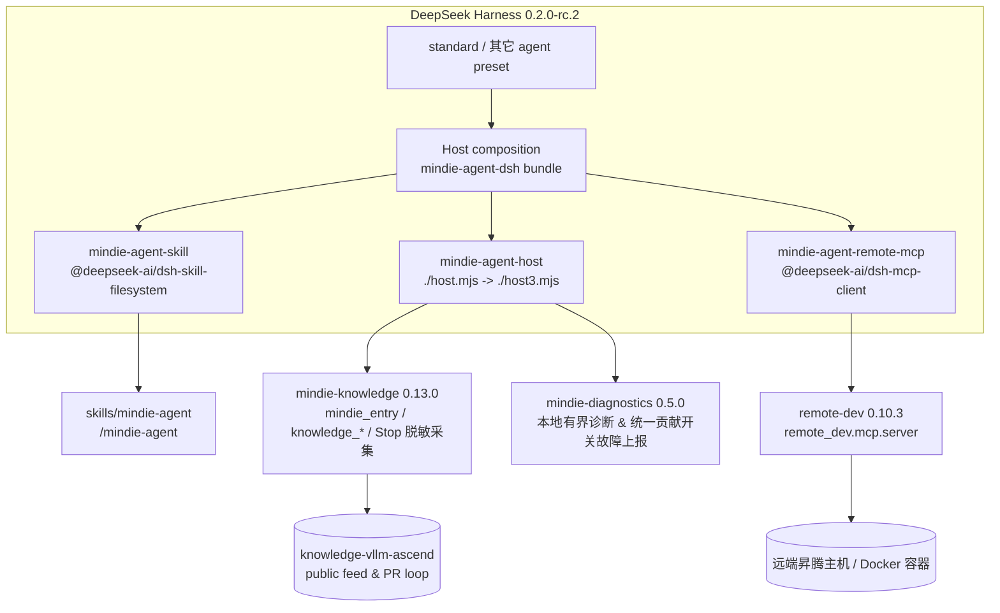

<p align="center">
  
</p>

<h1 align="center">MindIE Agent for DeepSeek Harness</h1>

> 插件发现：本仓库使用 GitHub topic [`dsh-plugin`](https://github.com/topics/dsh-plugin) 供 DSH 插件市场索引。

<p align="center">
  <b>面向昇腾（Ascend）NPU AI Infra 设计、开发与测试流程的 DeepSeek Harness 原生插件</b><br/>
  <sub>标准预设直接继承 · 领域知识检索与经验沉淀 · 远端 NPU 开发测试工具集 · 仅依赖 DSH 稳定插件</sub>
</p>

<p align="center">
  <a href="LICENSE"></a>
  <a href="package.json"></a>
  <a href="harness-compatibility.json"></a>
</p>

<p align="center">
  <b>中文</b> | <a href="README.en.md">English</a> ·
  <a href="#快速开始">快速开始</a> ·
  <a href="#装好之后怎么用">使用方式</a> ·
  <a href="#架构与稳定性边界">架构</a> ·
  <a href="#003-的贡献与故障上报">贡献与故障上报</a> ·
  <a href="#003-范围与已知限制">已知限制</a>
</p>

---

**MindIE Agent for DeepSeek Harness**（`mindie-agent-dsh`）是 [MindIE Agent](https://github.com/mindie-agent/mindie-agent) 面向 DeepSeek Harness（DSH）的原生插件适配器，当前正式版本为 `0.0.3`。

它面向昇腾（Ascend）NPU AI Infra 设计、开发与测试全流程，当前 `0.0.3` 已交付 **`vLLM-Ascend` 特性开发与测试**、**`AscendC` / `Triton` 算子实现验证**等能力（更多昇腾基础软件方向按路线图持续扩展）：

- **`/mindie-agent` 领域知识、Skill 与经验沉淀入口**：按需调用 `mindie_entry`、`knowledge_query`、`knowledge_explain`、`knowledge_distill`、`knowledge_feedback`、`knowledge_sync`，检索 `knowledge-vllm-ascend` 工程案例，并按 `L1`/`L2` 基础基线、`L3` Hermes 收敛与 `L4` RSI 去偏探索推进任务；开启贡献时自动完成 `session.v4.jsonl.zstd` 公开对话脱敏采集与社区 PR 发布；
- **`remote-dev` 远端 NPU 工具集**：在远端昇腾服务器或容器内读写文件、执行命令、运行测试并轮询长耗时后台任务；
- **生态支持**：当前 `v0.0.3` 同步支持 Claude Code（[`mindie-agent-cc`](https://github.com/mindie-agent/mindie-agent-cc)）、OpenAI Codex CLI（[`mindie-agent-codex`](https://github.com/mindie-agent/mindie-agent-codex)）、Kimi Code（[`mindie-agent-kimi`](https://github.com/mindie-agent/mindie-agent-kimi)）与 DeepSeek Harness（本仓库）。

> [!IMPORTANT]
> **稳定性设计：只依赖 DSH 标准发行版中的稳定插件。**
> 本适配器仅组合 `@deepseek-ai/dsh-skill-filesystem`、`@deepseek-ai/dsh-mcp-client` 两个非 experimental 包与本地 Host 入口 `./host.mjs`，**不引入任何 `@deepseek-ai/dsh-experimental-*`**，**不覆盖任何 DSH 内置行或内置预设**。
> 新增的三行（`mindie-agent-skill`、`mindie-agent-host`、`mindie-agent-remote-mcp`）均挂载在 Host 层，因此 **`standard` 标准预设及其它预设会直接继承**，无需切换专门模式。

## 快速开始

### 前置条件

| 依赖 | 要求 | 说明 |
| --- | --- | --- |
| DeepSeek Harness | `0.2.0-rc.2` | `package.json` 的可选 peer 依赖精确锁定该版本 |
| Node.js | `>= 22` | DSH 运行时要求 |
| Python | `>= 3.11` | 由 `uv` 选择/管理解释器（支持 3.11+） |
| `uv` | 任意近期版本 | 构建锁定运行时、提供 Python 解释器 |
| `git` & `gh` | 已安装并完成认证 | 拉取插件与知识源、支持社区知识 PR 与故障上报 |
| 网络 | 首次安装需要 | 拉取锁定组件与公共知识快照 |

### 第 1 步：构建锁定运行时并同步知识（先于启用 bundle）

`dsh-mcp-client` 与 Host 插件会在 DSH 启动/启用 bundle 时连接本地运行时，因此请**先**准备好持久化运行时：

```bash
MINDIE_TMP="${TMPDIR:-/tmp}/mindie-agent-dsh"
rm -rf "$MINDIE_TMP"
git clone --depth 1 --branch v0.0.3 https://github.com/mindie-agent/mindie-agent-dsh.git "$MINDIE_TMP"
uv run --quiet --no-project --python 3.11 "$MINDIE_TMP/scripts/setup.py"
```

验证标准：命令最终输出的 JSON 中报告锁定组件版本与就绪状态：

```json
{
  "status": "ready",
  "components": {
    "mindie-knowledge": "0.13.0",
    "remote-dev": "0.10.3",
    "mindie-diagnostics": "0.5.0"
  },
  "knowledge": { "status": "ready" }
}
```

`setup.py` 是幂等的：再次执行会按 `uv.lock` 重新校验运行时、更新持久化 worker 脚本（位于 `state_dir/bin/`）并做增量知识同步。运行时、配置、知识与 `remote-dev` 状态默认位于 `~/.local/share/mindie-agent/dsh` 与 `~/.config/mindie-agent/dsh`；临时克隆目录随后可以删除。

### 第 2 步：在 DSH 中安装并启用 bundle

在 DSH Web 的 **Plugins** 页面安装并启用：

```text
git+https://github.com/mindie-agent/mindie-agent-dsh.git#v0.0.3
```

也可以在具备 `plugin_manager` 工具的 Agent 会话中安装：

```text
plugin_manager(action="install_bundle",
               target="git+https://github.com/mindie-agent/mindie-agent-dsh.git#v0.0.3")
```

> 也可以运行 `dsh plugin --profile <name> add <spec>`。安装后在 **Plugins** 页面确认 `mindie-agent-dsh` 已启用；请勿手改 profile 的 `package.json` 或 `cordis.patch.yml`。

> [!WARNING]
> **早期 `0.0.2` 安装用户的同版本显式刷新说明**：
> 历史 `0.0.2` 发布曾对早期 `0.0.2`（源码提交 `828c375d1f546ed653250526465b8075c1691390`）执行授权的一次性同版本替换。以下说明仅适用于继续使用 `0.0.2` 的安装；升级到 `0.0.3` 使用上方的新标签。由于旧版更新器仅自动选择版本号严格大于（`>`）当前版本的发布，已安装早期 `0.0.2` 的环境**不会**自动拉取本次同版本更新；同时 DSH 进程内存中的 Node worker 在进程重启前仍会运行旧代码。
> 若你仍需使用早期 `0.0.2`，请按 **[同版本显式刷新指南](docs/same-version-refresh.md)** 使用发布对应的完整源码 SHA 显式刷新运行时（`scripts/setup.py`）与插件包（`dsh plugin --profile <name> add "git+https://github.com/mindie-agent/mindie-agent-dsh.git#<SHA>" --ignore-scripts` 或 `plugin_manager(action="install_bundle", ...)`），随后**完整退出并重启 DSH 进程**。刷新过程会完整保留已有的用户授权（`mindie-consent.json`）、社区配置与本地知识材料。

启用后打开**新会话**（已有会话保留其启动时的组合），输入 `/mindie-agent` 即可使用。

### 第 3 步：验证

```text
/mindie-agent 我准备在 vllm-ascend 里补一个融合算子的精度测试，请先结合知识库给出测试设计，再用 remote-dev 在远端 NPU 容器里跑通。
```

验证标准：

1. 技能由 `/mindie-agent` 显式注入（不进入模型自动目录），并调用 `mindie_entry(op="init")` 绑定当前任务；
2. Host 工具列表包含 `mindie_entry`、`knowledge_query`、`knowledge_explain`、`knowledge_feedback`、`knowledge_sync`，MCP 工具列表包含 `mcp__remote-dev__remote_*`；
3. 知识检索返回带 `ref` 的引用组，`knowledge_explain` 能读取指定条目或块正文；
4. 远端操作使用真实 host / port / container，长耗时任务可通过 `remote_job_*` 轮询。

## 装好之后怎么用

| 能力 | 触发方式 | 说明 |
| --- | --- | --- |
| 昇腾领域知识、工程经验、测试与排障参考 | **手动** `/mindie-agent <需求>` | 显式注入 Skill，调用 `mindie_entry` 与知识工具（`knowledge_query` / `knowledge_explain` / `knowledge_feedback`）；历史知识仅作参考，以当前环境实测为准 |
| 远端昇腾服务器 / 容器操作 | **默认常驻**，无需斜杠命令 | 直接用自然语言描述远端操作，Agent 调用 `mcp__remote-dev__remote_*` |
| 知识源刷新 | 由 `/mindie-agent` 会话内的 `knowledge_sync` 触发 | 仅在语料不可用/过期或用户要求最新知识时调用一次，不轮询 |
| 公开经验沉淀与工具故障上报 | **统一贡献开关控制** | 显式选择 `contribute` 后，每次回合结束（`agent/turn-stopping`）在后台完成 `session.v4.jsonl.zstd` 公开对话脱敏采集与社区 PR 发布，并开启脱敏故障上报 |

示例：

```text
/mindie-agent 帮我看看 vllm-ascend 里 MLA/GQA 首轴非连续 FIA 的已知验证结论，并给出在当前 910B 容器里复现精度的最小测试步骤。
```

```text
连上 192.0.2.21:22 的 vllm-dev 容器，把我本地刚改的测试同步过去，在 NPU 上跑 pytest，长任务转后台并持续看日志。
```

## 架构与稳定性边界



### Host 组合行与组件职责

| Host 行 ID | 使用的插件 / 入口 | 核心职责 | 是否 experimental |
| --- | --- | --- | --- |
| `mindie-agent-skill` | `@deepseek-ai/dsh-skill-filesystem` | 暴露 `/mindie-agent` 显式入口 Skill（`disable-model-invocation: true`） | 否 |
| `mindie-agent-host` | `./host.mjs`（挂载生成代数 `./host3.mjs`） | 注册原生 Host 工具（`mindie_entry`、`knowledge_query`、`knowledge_explain`、`knowledge_feedback`、`knowledge_sync`）、处理 `agent/turn-stopping` 会话采集、提供模型摘要桥接与后台代数更新 | 否 |
| `mindie-agent-remote-mcp` | `@deepseek-ai/dsh-mcp-client` | 启动锁定的 `remote-dev 0.10.3` 官方 MCP 服务（`remote_dev.mcp.server`） | 否 |

- **不覆盖**任何 DSH 内置行或预设，仅通过 `cordis.patch.yml` 执行 `insert`；DSH 标准预设改动不会被本适配器遮蔽。
- `package.json` 仅声明精确的 `@deepseek-ai/dsh@0.2.0-rc.2` 可选 peer 依赖，安装时不会把第二个 DSH 运行时拉入 profile。

## `0.0.3` 的贡献与故障上报

- **统一持久化贡献开关（`mindie-consent.json`）**：社区知识共享与工具故障自动上报共用同一个持久化开关。显式选择 `contribute` 会配置项目范围内的公开知识共享（默认上游 `mindie-agent/knowledge-vllm-ascend`，自动解析或创建个人 Fork）并启动原生后台故障上报 worker；选择 `disabled` 则同时停止两者的后续外发。
- **升级保持与旧版授权重确认**：已有的 `disabled`、`later`、`read-only` 选择在升级后保持关闭。旧版仅含知识共享授权（缺少统一授权 `choice_revision` / 标记为 `needs_choice`）的记录在升级或常规启动时**不会**自动获得故障上传权限，必须由用户显式重新确认一次后才允许上传故障报告。
- **三态严格区分**：系统严格区分（1）本地授权配置已写入 `mindie-consent.json`、（2）后台上报/整理 worker 正在运行、（3）外部 GitHub Issue 或知识 PR 已实际创建。可通过 `reporting-status` 只读查看 worker 与队列真实状态，详见 **[用户须知](skills/mindie-agent/references/user-notice.md)**。

## `0.0.3` 范围与已知限制

- **锁定运行时版本**：`mindie-knowledge 0.13.0`（`b900f11ef6be1edfe54e3d739b10588bc0cb0fce`）、`remote-dev 0.10.3`（`f441d52f8dcb227ad31adeeeb1d66da4a28915bb`）、`mindie-diagnostics 0.5.0`（`6460cde3a50a7f91c9ded38557a7f921654f0c6a`）。
- **历史同版本刷新边界**：`0.0.2` 曾替换早期 `0.0.2`（`828c375d1f546ed653250526465b8075c1691390`）。继续使用 `0.0.2` 的用户需按 [`docs/same-version-refresh.md`](docs/same-version-refresh.md) 显式刷新运行时与插件 bundle，并重启整个 DSH 进程。
- **`remote-dev` 状态跨会话共享**：远端作业记录位于 `~/.local/share/mindie-agent/dsh/state/remote`，在当前 Host 下跨会话可见。
- **后台自动更新边界**：稳定启动器 `host.mjs` 支持在 DSH Host 存活期间定时检查正式 Release 并切换子插件代数；DSH 停止期间不依赖操作系统级后台常驻计划任务。
- **基准测试边界**：`mindie-bench` 已支持 DSH 作为 L1/L2 G0–G2 原生评测 harness（详见 [`docs/benchmark.md`](docs/benchmark.md)），G3 原生采集评测在 `mindie-bench` 侧暂未接入 DSH。

## 开发、测试与发布基准

```bash
# 离线契约、协议与组件单元测试（不写用户目录）
pytest -q
node --test tests/test_summary_endpoint.mjs

# 只检查前置条件与路径，不构建运行时
uv run --quiet --no-project --python 3.11 scripts/setup.py --dry-run
```

### `0.0.3` 发布基准测试（Release Benchmark）

本仓库随 `0.0.3` 正式版发布可复现的 CPU 微基准测试资产（`benchmark-results.json`、`benchmark-results.md`）：
- [`benchmarks/release.json`](benchmarks/release.json)（由 `benchmarks/release.py` 执行）测量 100 条消息的 DSH v4 `session.v4.jsonl.zstd` 公开对话提取与隐藏推理过滤延迟（用例 `public-transcript`，指标 `public_100_message_parse_latency`，单位 `us/op`）。
- 上述 CPU 微基准仅证明本地解析的耗时基线，与常备昇腾 A2/A3 NPU 真机集成验收及 `mindie-bench` 端到端 Agent 研发任务评估相互独立。详见 [`docs/benchmark.md`](docs/benchmark.md) 与 [`docs/verification.md`](docs/verification.md)。

## 许可证

本项目基于 [MIT License](LICENSE) 开源。
