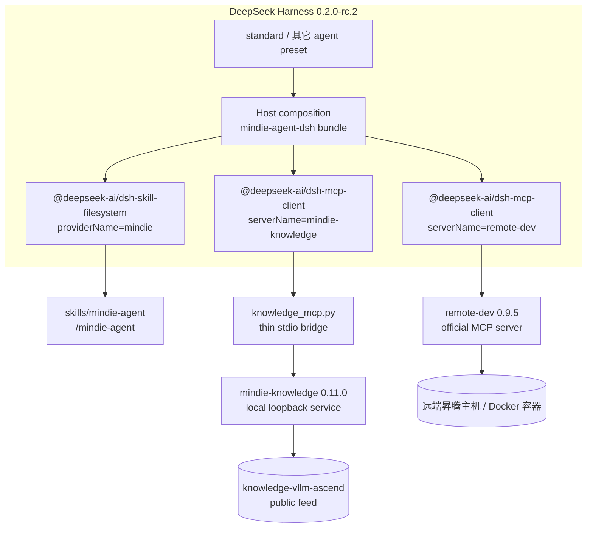

<p align="center">
  
</p>

<h1 align="center">MindIE Agent for DeepSeek Harness</h1>

<p align="center">
  <b>面向昇腾（Ascend）NPU AI Infra 研发、测试与排障的 DeepSeek Harness 原生插件</b><br/>
  <sub>标准模式即装即用 · 领域知识只读检索 · 官方 remote-dev NPU 工具集 · 仅依赖 DSH 稳定插件</sub>
</p>

<p align="center">
  <a href="LICENSE"></a>
  <a href="package.json"></a>
  <a href="harness-compatibility.json"></a>
</p>

<p align="center">
  <b>中文</b> | <a href="README.en.md">English</a> ·
  <a href="#快速开始">快速开始</a> ·
  <a href="#装好之后怎么用">使用方式</a> ·
  <a href="#架构与稳定性边界">架构</a> ·
  <a href="#001-范围与已知限制">已知限制</a>
</p>

---

**MindIE Agent for DeepSeek Harness**（`mindie-agent-dsh`）是 [MindIE Agent](https://github.com/mindie-agent/mindie-agent) 的 DSH 原生适配器，`0.0.1` 首发版本。

它把 MindIE Agent 的两项核心能力接入 DSH：

- **`/mindie-agent` 领域知识与 Skill 入口**：按需检索 `knowledge-vllm-ascend` 等昇腾工程知识；
- **官方 `remote-dev` 远端 NPU 工具集**：在远端昇腾服务器/容器内读写、执行、跑测试和轮询长任务。

> [!IMPORTANT]
> **稳定性设计：只依赖 DSH 标准发行版中的稳定插件。**
> 本适配器只组合 `@deepseek-ai/dsh-skill-filesystem` 与 `@deepseek-ai/dsh-mcp-client` 两个非 experimental 包，**不引入任何 `@deepseek-ai/dsh-experimental-*`**，**不覆盖任何 DSH 内置行或内置预设**。
> 新增的三行都挂在 Host 层，因此 **`standard` 标准模式以及其它预设都会直接继承**，用户不需要切换模式，也不存在“MindIE 模式”与标准模式的配置漂移。

## 快速开始

### 前置条件

| 依赖 | 要求 | 说明 |
| --- | --- | --- |
| DeepSeek Harness | `0.2.0-rc.2` | `package.json` 的 peer 依赖精确锁定该版本 |
| Node.js | `>= 22` | DSH 运行时要求 |
| Python | `>= 3.11` | 由 `uv` 选择/管理 3.11，不要求系统 Python 正好是 3.11 |
| `uv` | 任意近期版本 | 构建锁定运行时、提供 3.11 解释器 |
| `git` | 任意近期版本 | 拉取插件与知识源 |
| 网络 | 首次安装需要 | 拉取固定组件与公共知识快照 |

### 第 1 步：构建锁定运行时并同步知识（先于启用 bundle）

`dsh-mcp-client` 会在 DSH 启动/启用 bundle 时立即连接 MCP server，因此**先**把运行时准备好，避免首次连接失败：

```bash
MINDIE_TMP="${TMPDIR:-/tmp}/mindie-agent-dsh"
rm -rf "$MINDIE_TMP"
git clone --depth 1 --branch v0.0.1 https://github.com/mindie-agent/mindie-agent-dsh.git "$MINDIE_TMP"
uv run --quiet --no-project --python 3.11 "$MINDIE_TMP/scripts/setup.py"
```

验证标准：命令最终输出的 JSON 中：

```json
{
  "status": "ready",
  "components": {
    "mindie-knowledge": "0.11.0",
    "remote-dev": "0.9.5",
    "mindie-diagnostics": "0.4.1"
  },
  "knowledge": { "status": "ready" }
}
```

`setup.py` 是幂等的：再次执行会按 `uv.lock` 重新校验运行时、重写引擎配置并做增量知识同步。运行时、配置、知识与 `remote-dev` 状态默认位于 `~/.local/share/mindie-agent/dsh` 与 `~/.config/mindie-agent/dsh`；临时克隆目录随后可以删除。

### 第 2 步：在 DSH 中安装并启用 bundle

在 DSH Web 的 **Plugins** 页面安装并启用：

```text
git+https://github.com/mindie-agent/mindie-agent-dsh.git#v0.0.1
```

也可以在具备 `plugin_manager` 工具的 Agent 会话中安装：

```text
plugin_manager(action="install_bundle",
               target="git+https://github.com/mindie-agent/mindie-agent-dsh.git#v0.0.1")
```

> 说明：`dsh plugin --profile <name> add <spec>` 只负责 pnpm 安装，不会替用户勾选 bundle。安装后在 **Plugins** 页面启用 `mindie-agent-dsh` 即可；不要手改 profile 的 `package.json` 或 `cordis.patch.yml`。

启用后打开**新会话**（已有会话保留其启动时的组合），输入 `/mindie-agent` 即可使用。

### 第 3 步：验证

```text
/mindie-agent 我准备在 vllm-ascend 里补一个融合算子的精度测试，请先结合知识库给出测试设计，再用 remote-dev 在远端 NPU 容器里跑通。
```

验证标准：

1. 技能被注入（`/mindie-agent` 是用户显式入口，不进入模型自动目录）；
2. 工具列表出现 `mcp__mindie-knowledge__knowledge_query` / `knowledge_explain` / `knowledge_sync` 与 `mcp__remote-dev__remote_*`；
3. 知识检索返回带 `ref` 的引用组，`knowledge_explain` 能读到正文；
4. 远端操作使用真实 host / port / container，长任务可通过 `remote_job_*` 轮询。

## 装好之后怎么用

| 能力 | 触发方式 | 说明 |
| --- | --- | --- |
| 昇腾领域知识、工程经验、测试与排障参考 | **手动** `/mindie-agent <需求>` | 显式注入 Skill，再按需调用只读知识工具；知识永远只是参考，以当前环境实测为准 |
| 远端昇腾服务器 / 容器操作 | **默认常驻**，无需斜杠命令 | 直接自然语言描述远端操作，Agent 调用 `mcp__remote-dev__remote_*` |
| 知识源刷新 | 由 `/mindie-agent` 会话内的 `knowledge_sync` 触发 | 仅在语料不可用/过期或用户要求最新知识时调用一次，不轮询 |

示例：

```text
/mindie-agent 帮我看看 vllm-ascend 里 MLA/GQA 首轴非连续 FIA 的已知验证结论，并给出在当前 910B 容器里复现精度的最小测试步骤。
```

```text
连上 192.0.2.21:22 的 vllm-dev 容器，把我本地刚改的测试同步过去，在 NPU 上跑 pytest，长任务转后台并持续看日志。
```

## 架构与稳定性边界



### 只依赖标准模式插件的具体含义

| 行 | 使用的插件 | 来源 | 是否 experimental |
| --- | --- | --- | --- |
| `mindie-agent-skill` | `@deepseek-ai/dsh-skill-filesystem` | DSH 标准预设同款 provider | 否 |
| `mindie-agent-knowledge-mcp` | `@deepseek-ai/dsh-mcp-client` | DSH 标准发行版 MCP 桥 | 否 |
| `mindie-agent-remote-mcp` | `@deepseek-ai/dsh-mcp-client` | 同上 | 否 |

- **不覆盖**任何 shipped row / preset，只做 `insert`；因此 DSH 升级带来的标准预设改动不会被本适配器遮蔽。
- **不引入**自定义 Cordis Host 插件；知识桥只是 MCP server，`remote-dev` 直接使用组件官方 server 入口。
- `package.json` 只声明精确的 `@deepseek-ai/dsh@0.2.0-rc.2` 可选 peer，安装时不会把另一个 DSH 运行时拖进 profile。

## 0.0.1 范围与已知限制

- **知识检索是只读的**：`knowledge_query`、`knowledge_explain`，外加显式 `knowledge_sync`。0.0.1 **没有** `knowledge_feedback`。
- **无会话结束采集、无社区贡献、无自动故障上报**：DSH 的公开会话格式是 zstd JSONL，本版本不实现解析，也不假装采集成功；引擎配置里的采集适配器会在被调用时明确报错。
- **知识身份是 Host 级 `dsh`**，不是 per-session；不要宣称会话隔离。
- **`remote-dev` 状态是 Host 级共享**：作业记录位于 `~/.local/share/mindie-agent/dsh/state/remote`，跨会话可见。
- 已验证平台见 [`docs/verification.md`](docs/verification.md)；`0.0.1` 只在 **macOS 27.0.1 arm64 + DSH 0.2.0-rc.2** 上完成实机验收，其它平台请以实际测试为准。
- 不提供自动更新器；升级时重新执行 `setup.py` 并在 Plugins 页面切换到新 tag。

## 开发与测试

```bash
# 无需网络 / 不写用户目录的契约与协议测试
python3 -m unittest discover -s tests -v

# 只检查前置条件与路径，不构建运行时
uv run --quiet --no-project --python 3.11 scripts/setup.py --dry-run

# 手工探测 knowledge MCP 协议
printf '%s\n' '{"jsonrpc":"2.0","id":1,"method":"initialize","params":{"protocolVersion":"2026-07-28"}}' \
  '{"jsonrpc":"2.0","id":2,"method":"tools/list","params":{}}' \
  | uv run --quiet --no-project --python 3.11 scripts/knowledge_mcp.py knowledge
```

发布配套关系、提交哈希与实机证据见 [`docs/verification.md`](docs/verification.md) 与 [`harness-compatibility.json`](harness-compatibility.json)。

## 许可证

本项目基于 [MIT License](LICENSE) 开源。
